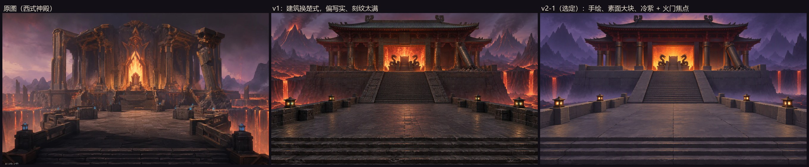

# 第三章 · 火神殿（用户参考图改楚式）：场景概念图

2026-11-08 用户发来一张 AI 生成的熔岩神殿图（`user-ref.webp`），问「这个场景你能做吗？是否符合我们游戏的美术？」，随后要求「改成符合我们游戏的建筑，重新生成这样的场景」。
本目录保留它的构图，把建筑和画风换成第三章的设定。对照的规范：[composition.md](../../../docs/art/composition.md)、[ch3-look.md](../../../docs/art/ch3-look.md)、[art/README.md](../../README.md)，文化依据见 [zhurong-kit-31.md](../../../docs/art/zhurong-kit-31.md) 第 1 节。



## 1. 用户参考图的评估

| 项 | 结论 |
|---|---|
| 构图 | **可以直接用**：中心对称 + 右侧一根斜倒的柱子作破口（composition.md 3.5「神殿、王座必须正中，留一个破口」）；台阶 → 广场 → 大阶 → 火门的纵深引导线收敛到王座；锚点只有一个（火门）。广场空、两侧有齐腰矮墙，本身就是一块首领场。 |
| 建筑 | **不符合**：希腊式柱廊 + 哥特尖拱火门，是西式奇幻神殿。第三章取《山海经》祝融 + 楚地风物（楚式高台建筑、铸铜、朱漆），放进游戏会和 3-1 的楚式宫门、鼓楼不是一个世界。 |
| 细节 | **不符合**：满件鎏金描边和细刻花（art/README「厚实大形、少量中尺度纹饰」）；鎏金的亮度和精英金边、首领发光撞档（ch3-look：场景里不出现同等亮度的金色）。 |
| 颜色 / 光 | 大体可以：暖火门 + 紫天，熔岩只在两侧崖口。蓝色灯偏冷蓝而不是青金，数量偏多。 |
| 物理逻辑 | 通过：碰熔岩的都是石头。 |

`composition_check`：颜色 65 / 31 / 4、明度均 25 跨 45、密度 24 / 62 / 14（疏密比 41），提示「留白不足」。

## 2. 生成记录（Tripo Studio 图片页，GPT Image 2.5，16:9，每轮 2 张，免费额度 0 积分，新账号）

| 版本 | 文件 | 做法 | 结论 |
|---|---|---|---|
| v1 | `fire-temple-v1-1.webp`、`fire-temple-v1-2.webp` | 纯文字，按参考图构图逐项描述，建筑改楚式高台 + 铸铜柱 + 铸铜瓦重檐 + 朱漆梁；火门里是空王座 + 两条铜龙扶手 | 建筑和构图对了；但画风写实、墙柱满刻回纹、远山淌满熔岩、整屏红褐。`composition_check`：v1-1 颜色 77 / 19 / 4、密度 1 / 40 / 59；v1-2 颜色 73 / 23 / 4、密度 1 / 33 / 65 → 细节太满、没有留白 |
| **v2-1（选定）** | `fire-temple-v2-1.webp` | 以 v1-1 为参考图只做减法：手绘风格、去回纹、整块大石、远山去熔岩并逐层退进雾、低雾带、去红褐、天在殿顶后最亮（逆光剪影） | 画风回到 3-1 v3 那一套手绘；台基、阶墙、矮墙是几块素面大石；远山是层层退进紫雾的剪影，殿脚和熔海上有低雾带；天在殿顶后最亮，大殿成剪影带暖边；火门是唯一的高饱和焦点。`composition_check`：颜色 67 / 30 / 2、明度均 24 跨 29、密度 5 / 65 / 31。「没有点缀色」是因为画面里只有火门一处暖光（ch3-look：没有怪的视角里正常）；「细节太满」主要来自台阶和瓦垄的密集横线，进引擎后台阶程序生成、瓦面按大块面处理 |
| v2-2 | `fire-temple-v2-2.webp` | 同上，同一轮另一张 | 和 v2-1 几乎一样，熔瀑更少、天更暗，逆光不如 v2-1。颜色 69 / 28 / 2、密度 5 / 60 / 35 |

v2 的矮墙灯画成了暖橙灯笼；进引擎时照第三章规矩换成 3-1 套件的青金栏墩灯（`SM_Tripo_ZhurongParapetLantern`），只放在主路上，不重画概念图。

## 3. 能不能做：拆件表（远 / 中 / 近三层，照 v2-1）

可以做，和 ZR31（3-1 样板场景）是同一条路。看得见、走不到的远景件一律程序化，Tripo 只做玩家走得到、看得清的近 / 中景件。

| 层 | 件 | 做法 |
|---|---|---|
| 远 | 层叠火山峰、熔海暗壳、两侧崖壁、细熔瀑 | 程序生成（多棱硬边、平涂）+ `LevelKit.Ch3LavaCrust` 暗壳 + `M_Lava` 熔瀑；天 / 雾 / 低雾带沿用 ZR31 的氛围设置 |
| 中 | 火神殿殿身（铸铜柱、铸铜瓦重檐、朱漆梁） | Tripo，30000 面，去光处理 + 4K 贴图 |
| 中 | 火门王座（空王座 + 两条铜龙扶手） | Tripo 单独一件；门里的火走 `FX_Fire` 挂点，网格上不长火 |
| 中 | 斜倒的断柱 + 碎石堆 | Tripo 单独一件（地标的不对称破口，可做可破坏件） |
| 近 | 高台台基、中央大阶、前景台阶、广场大石板 | 程序生成：台阶要和角色控制器尺度一致（3-1 宫前大阶两次被 Tripo 画成石供桌） |
| 近 | 矮墙、方石掩体 | 程序生成，按掩体高度分级（齐腰半掩体），一眼认得出 |
| 小 | 栏墩青金灯、铜火盆 | 复用 3-1 套件 |


### v1 提示词

```
ONE symmetrical eye-level view of an open-air fire god throne hall on a high stone terrace above a lava abyss, in ancient Chinese Chu-kingdom style (Warring States period). NOT Greek, NOT Gothic, NOT European, no pointed arches. MUST INCLUDE, from near to far: wide low stone steps along the bottom edge of the frame; a broad, flat, plain basalt-paved plaza in the middle, quiet and almost empty like a clean arena; a few low thick stone parapet walls and square stone blocks along both sides of the plaza as waist-high cover, with ONLY four small teal-gold lanterns set into the parapet tops; beyond the plaza, one grand central stair climbing a tall stone terrace platform (Chu high-terrace architecture); on the terrace, a massive palace hall with thick dark cast-bronze columns, a heavy double-eaved hip roof of cast bronze tiles, dark red lacquer beams, simple bold forms; at the exact centre, a huge rectangular gateway opening filled with roaring fire, and inside the fire an EMPTY monumental stone throne with two coiled bronze dragon armrests; on the right, ONE broken bronze column leaning against the hall as the only asymmetry; on both sides the terrace edge drops into deep cliffs with a few thin lavafalls into a dark crusted lava sea; far behind, jagged volcanic peaks fading layer by layer into violet smoke. Everything touching lava is basalt, stone or cast iron. No wood near lava, no banners, no flag poles, no statues, no tall lamp posts. Style: stylized hand-painted 3D game environment concept art for a fantasy first-person shooter rooted in ancient Chinese mythology. Chunky, clean, readable shapes and bold silhouettes, thick simple forms, painterly surfaces with no fine carvings, no noisy cracks, no gold filigree; ornament only as a few broad cloud-scroll bands in dull bronze and red lacquer. Colour script: 60% cool dark violet basalt rock and an indigo-violet smoky sky, 30% copper bronze and warm grey stone, only 10% molten lava orange; the fire gateway is the brightest and most saturated value in the image. The lava sea is dark crust with a few glowing cracks, not a bright orange sea. Warm light only around the fire gateway and in a narrow band on the horizon. Large quiet dark areas, clean negative space of smoke. Wide 16:9 cinematic shot. NO text, NO UI, NO people, NO creatures, NO watermark.
```

### v2 提示词（附 v1-1 作参考图）

```
MANDATORY CHANGES to the attached image (keep its exact composition and camera: steps at the bottom, plaza, low parapets with four small lanterns, central stair up the terrace, Chinese palace hall, square fire gateway with the empty throne and two bronze dragons, the broken column leaning on the right, lavafalls at both sides, peaks behind):
1. Repaint it as stylized hand-painted 3D game concept art, NOT photorealistic: chunky simplified shapes, big flat painterly planes, soft brush texture, no wet reflections, no gritty stone noise.
2. Remove ALL engraved fret patterns and carvings from the terrace walls, stair side walls, parapets and columns. The terrace is built from a few large plain stone blocks. Columns are plain dark bronze cylinders with only one simple band near the top and bottom.
3. Plaza floor: a few very large plain matte slabs, almost one quiet flat surface.
4. Background peaks: plain dark violet silhouettes WITHOUT any lava streaks, receding layer by layer into violet smoke, each farther layer lighter and closer to the sky colour. A low band of mist along the foot of the terrace and over the lava.
5. The lava sea is mostly dark crust with only a few glowing cracks; keep only two thin lavafalls on each side.
6. Colour: remove the overall red-brown cast. Sky indigo-violet smoke, brightest just behind the hall roof so the hall reads as a dark silhouette with a warm rim light. Shadows cool violet, stone warm grey, bronze dull copper, red lacquer only on the beams. The fire gateway is the only bright, saturated warm focus.
7. Roof: simpler heavy roof of dark cast bronze tiles, fewer ornaments on the ridge.
STRICTLY NOTHING ELSE added. No banners, no statues, no people, no text, no watermark. Wide 16:9.
Style: stylized hand-painted 3D game environment concept art for a fantasy first-person shooter rooted in ancient Chinese mythology, clean readable shapes, large quiet dark areas, 60% cool dark violet, 30% warm grey stone and copper bronze, 10% lava orange.
```
