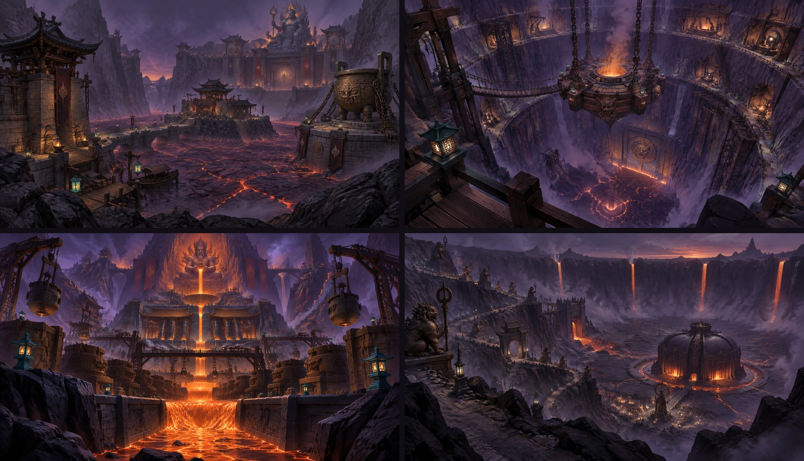

# 第三章 · 祝融火狱：场景概念图（4 张，2026-11-06）

用户要求：「生成 4 张『祝融火域』的游戏场景概念图」。按第三章四张图各出一张标志性视角：

| # | 关卡 | 视角 | 依据 |
|---|---|---|---|
| 1 | 3-1 熔湖堤道 | 火口南沿远眺熔湖关隘：渡口关楼 → 湖心税关 → 锚链大墩镇湖鼎 → 对岸瓮城宫门 → 崖顶祝融像 | `docs/level-design/maps/3-1.md`、ch3-v2 §5.1 |
| 2 | 3-2 铸神井 | 井口往下看：环台、凿壁工坊窟、链桥、井心悬炉锻台、井底熔泉和铸门 | ch3-v2 §5.2 |
| 3 | 3-3 铸范大坊 | 低机位仰望三级梯坊：熔铜河流向镜头、两侧范列吊车、鼓风正殿、正上方火神王座 | ch3-v2 §5.3（用户参考图构图） |
| 4 | 3-4 祝融炉心 | 火口南沿眺台俯瞰：祝融神道盘下火口壁、铜人、闸楼、补给营、护城渠单桥、铁心炉心殿 | ch3-v2 §5.4 |

色彩按 [docs/art/ch3-look.md](../../../docs/art/ch3-look.md) 的 631：冷暗紫玄武岩 60%、铜 / 暖灰铸铁 30%、熔岩橙 10%（最亮最饱和）；天顶靛紫烟、只有地平线一窄条暖色；青金只用在小引导灯。

生成：Tripo Studio 图片页（`https://studio.tripo3d.ai/zh/workspace/generate-image`），GPT Image 2.5，16:9，每条 1 张，不传参考图；用户已登录的 Chrome、新账号，走免费图片额度（0 积分），没做 4K 放大、没提交 3D 任务。
Tripo 的图像模型会改写长提示词，所以「必须有」的内容放最前，风格放最后。

## 结果



文件是 Tripo 原样输出的 1792 × 1024 WebP（没重新编码）：`3-1-molten-lake-pass.webp`、`3-2-forge-well.webp`、`3-3-grand-foundry.webp`、`3-4-furnace-heart.webp`；`contact-sheet.jpg` 是 2 × 2 总览。

| # | 提示词要素落实 | 和设定的出入 |
|---|---|---|
| 3-1 | 渡口关楼 + 码头、石堤、湖心税关岛、右侧锚链墩上被铁链拴住的镇湖鼎、对岸瓮城宫门、崖顶祝融像全有；熔湖是暗壳 + 亮缝 | 祝融像画成了人形坐神（火焰冠），没有「兽身」 |
| 3-2 | 环台、凿壁工坊窟、链桥、井心四链悬炉（有平台和炉口）、井底熔泉、铸门全有；俯视的眩晕感成立 | 栈架偏少 |
| 3-3 | 熔铜河正对镜头逐级跌落、两侧铸范列、吊车浇包、铁桥、鼓风正殿、正上方王座 | 王座画成了「坐神双手倾泻熔岩进承盘」；熔岩橙占比明显超 10%（3-3 王座视角按 ch3-look 允许多一些） |
| 3-4 | 火口南沿眺台、沿壁之字神道 + 铜人、牌坊、闸楼、铁铸圆顶炉心殿 + 熔渠环、补给营暖光和像、四道熔瀑 | 单桥不明显；画风比另外三张写实、偏灰 |

## 共用风格尾句

```
Style: stylized hand-painted 3D game environment concept art for a fantasy first-person shooter rooted in ancient Chinese mythology. Chunky, clean, readable shapes and bold silhouettes, painterly surfaces without noisy detail. Colour script: 60% cool dark violet basalt rock and an indigo-violet smoky sky, 30% copper bronze and warm grey cast iron, only 10% molten lava orange, which is the brightest and most saturated value in the image. Lava lakes are dark violet crust with a few glowing cracks, not a bright orange sea. Warm colour only in a narrow band on the horizon. A few small teal-gold lanterns mark the path. Large quiet dark areas, dark foreground rocks framing the shot, clean negative space of smoke. Wide 16:9 cinematic shot. NO text, NO UI, NO people, NO creatures, NO watermark.
```

## 1 · 3-1 熔湖堤道

```
ONE wide establishing shot of a narrow molten lava lake pass inside a volcanic crater, seen from the south crater rim at eye height. MUST INCLUDE, from near to far: a fortified ferry gate tower of ancient Chinese stone and dark timber on the near shore with a small dock; short stone causeways with low parapet walls crossing the lake in a few segments; a customs fort with a toll pavilion on a rocky island in the middle of the lake; on the right, a massive basalt pier where a giant bronze ding cauldron is bound by heavy iron anchor chains; on the far shore, a high terrace with a walled barbican, two drum towers and a huge palace gate of the fire god; on the cliff top above the gate, a colossal seated stone statue of the fire god Zhurong, human face and beast body, crown of flames, watching over the pass. The lake is a pinched pass between cliffs, not an open sea.
```

## 2 · 3-2 铸神井

```
ONE dramatic downward view into a gigantic circular forge shaft carved into dark violet basalt, seen from a timber walkway on the upper rim. MUST INCLUDE: three ring terraces spiralling down the well wall, with forge workshop caves carved into the rock behind them; timber and iron scaffolds clinging to the wall and one chain bridge crossing the void; at the centre of the well, a heavy bronze suspended furnace platform hanging on four giant chains, with a walkable deck around its glowing furnace mouth; at the very bottom, a bubbling molten spring; in the bottom wall, a huge cast-bronze gate glowing from behind. Strong vertigo and deep perspective, smoke rising from below, the depth fading into dark violet.
```

## 3 · 3-3 铸范大坊

```
ONE low-angle view looking UP a vast terraced foundry inside a volcano, climbing in three great steps toward a fire god throne. MUST INCLUDE: a river of molten copper flowing straight toward the camera down the centre of the image, spilling over each terrace edge as small lavafalls; on both sides of the river, rows of giant clay casting moulds, crucible ladles hanging from timber cranes, iron gantry bridges over the channel; on the middle terrace a large ancient Chinese bellows hall with heavy bronze roofs; at the top, directly above the vanishing point, a monumental stone throne carved into a tall rock tower, with a column of lava pouring from it into a casting basin. Warmer orange smoke around the throne, cool violet shadows near the camera.
```

## 4 · 3-4 祝融炉心

```
ONE wide view from a high lookout on the south rim of a deep lava crater, looking down and across to its floor. MUST INCLUDE: a sacred stone road spiralling down the crater wall in switchbacks, lined with giant bronze guardian statues and one stone ceremonial archway; a sluice gate tower over a molten channel halfway down; at the crater floor, a round domed furnace hall cast of black iron, shaped like an iron heart, ringed by a moat of molten iron with ONE narrow stone bridge; furnace mouths in the hall's shell glowing orange; small warm lights of a camp and a statue before the bridge; four thin lavafalls pouring into the crater from the rim. Solemn, sacred, final-battle mood.
```
