# 特效风格审查 · A 射击核心 / B 爆炸 · 元素 · 状态 · 护盾 / C 首领与预警 / D 环境

用户要求：「要保证特效的风格也符合游戏的美术风格哲学」。本轮把特效打磨 A、B 两路已经完成的特效，按
[`docs/art/fx-style.md`](../../fx-style.md) 末尾的 8 条自查清单逐项过了一遍，不符合的和明显的小偏差都在 A、B 自己的文件里改掉了。
准则的三份原始依据（`art/README.md` 的美术目标、`art/pipeline/pipeline.toml` 的 `[concept].style`、
`docs/unity-art-pipeline.md` §4 StylizedLit）一并对照过。只调参数、色阶、形状和贴图生成，玩法和判定一处没动。

## 怎么看的

- **三种地面**：新加的 `bash scripts/unity/bridge.sh playtest fx-style`（`FxStyleSuite`，场景 TestArena）在同一块场地上先后铺
  **亮沙**（测试场本身）、**雪**（霜山雪地层）、**熔岩**（熔火玄武岩 + 一池岩浆），每种地面拍同一组：爆炸第三人称 / 第一人称、
  冲锋枪和霰弹开火、五种状态一排 + 近景、护盾受击 / 破盾 / 破甲、焚雷 / 归墟 / 熔金、弹孔焦痕、出生显形 / 死亡迸散。
  每种地面按那一章的环境色出（`FxTone.Override`），旁边都站着手绘的怪当参照（清单第 7 条）。
- **沙地近景**：`fx-shot`（18 把枪的枪口、弹孔四地表、焦痕、命中层、暴击）、`fx-blast`（爆炸三档序列、反应、状态远近景、护盾护甲、火舌、出生死亡）、
  `blade-fp`（碎刃三段斩）。
- **参照**：`docs/art/review/unity-combat/` 的怪物 / 首领拼图和关卡截图——模型是哑光的手绘固有色、两三个主色块、中等饱和度，
  StylizedLit 的软阶梯明暗，暗部偏冷。特效要和它们放在一起像同一个游戏。
- 拼图：`docs/art/review/fx-polish/style/`（`python scripts/unity/fx_style_sheets.py <改前> <改后>` 生成，每组上一行改前、下一行改后）。

结论分三档：**符合**、**小偏差**（方向对，个别参数越线）、**不符合**（违背准则的某一条）。清单编号：
① 25% 大小读得出大形 ② 色阶 ≤ 3、无大片纯白 / 灰雾 / 写实烟 ③ 元素色与章节底色 ④ 无细碎颗粒 / 噪点 / 密集裂纹 ⑤ 三种地面上敌人轮廓与准星清楚
⑥ 蓄 → 爆 → 余韵、0.6 s 内交代完 ⑦ 和模型、场景像同一个游戏 ⑧ 接 FxBudget、低画质体面。

## 总表

| 路 | 特效 | 审查结论 | 主要问题（违背的清单条） | 改后 |
|---|---|---|---|---|
| A | 枪口火焰（18 把） | 不符合 | ②③⑦ 纯加法，亮沙 / 雪上只剩奶白一团，没有主色和暗边；白热芯是一团柔光 | 符合 |
| A | 抛壳 | 符合 | — | — |
| A | 曳光 | 符合 | — | — |
| A | 弹孔 / 焦痕 | 小偏差 | ④ 焦痕里细碎的火星点和灰点、沙坑的沙粒噪点 | 符合 |
| A | 命中火花（盾 / 甲 / 血肉 / 弱点） | 小偏差 | ②⑦ 0.4–0.5 m 的柔白光球，比旁边的模型亮一截；④ 弹着尘是灰的 | 符合 |
| A | 暴击 | 符合 | — | — |
| A | 碎刃刀光 | 不符合 | ①② 一张渐变的半透明面，没有墨笔起收锋，第三段侧看补宽时会出一块四方形面片；刃口纯白 | 符合 |
| B | 爆炸三档 | 不符合 | ①④ 每帧 12 个小团、每团各有白热芯，读成泡泡纸；②③ 灰色鹅卵石烟、灰描边，沙寺的尘不是暖沙色；② 1–4 m 纯白闪光 | 符合 |
| B | 元素反应（熔金 / 焚雷 / 封脉 / 归墟 / 崩解） | 不符合 | ② 2–3 m 纯白柔光罩住整个人，归墟一团 4–5 m 的白；③ 熔金余韵是灰石烟；灯光把亮沙照成一片白 | 符合 |
| B | 状态 · 灼烧 | 符合 | — | — |
| B | 状态 · 感电 | 符合 | （上一轮已把电纹收细） | — |
| B | 状态 · 蚀化 | 小偏差 | ③⑦ HDR 酸绿 + 酸绿轮廓光，整只刷成霓虹绿；④ 一层细碎小泡；斑块被 uv 岛缝切成方块 | 符合 |
| B | 状态 · 眩晕 | 小偏差 | ④ 星尾一串细碎柔光点 | 符合 |
| B | 状态 · 减速（冰壳） | 不符合 | ②④ 细晶格（密集裂纹）+ 白格边 + 闪点 + 白轮廓光 + 白染色，整只发白 | 小偏差（见遗留） |
| B | 护盾球壳 / 破盾 | 不符合 | ④ 150 格细六边形读成科幻细网；② 破盾一下整壳白成一个蛋，脚下一大片亮 | 符合 |
| B | 破甲 | 小偏差 | ② 柔白闪光 + 闪光灯把脚下照出一片亮黄 | 符合 |
| B | 火舌（FlameTongue） | 符合 | — | — |
| B | 出生显形 | 小偏差 | ②⑦ 显形前沿 ×4.2 + 白热底，0.3 s 时整只怪是白的；光墙是白金色的柔光柱 | 符合 |
| B | 死亡迸散 | 小偏差 | ② 1.5 m 柔白闪光；③ 深灰柔烟 | 符合 |

（细节见下文。拼图都在 `style/`。）

## A 路 · 射击核心

### A1 枪口火焰 —— 不符合 → 已改

- **问题**：火焰片是纯加法（`SrcAlpha, One`），贴图亮度从芯到边是一条连续渐变。加在亮沙、雪这种亮地面上，主色和暗边全被冲成奶白，
  只剩一团发白的星芒（`S6` 改前的雪地霰弹最明显）；白热芯是一颗高斯柔光球。违背 ②「2–3 个色阶」、③「火：橙红主色、金黄亮芯、赭红暗边」、⑦。
- **改法**：
  - `scripts/unity/fx_shot_textures.py`：火焰类格的亮度硬化成三段（亮芯 1 / 主色 0.76 / 暗边 0.52，`band3`），色阶跟着形状走（芯和主色各是一条更窄的火舌），
    不再沿长度切出竖线；白热芯改成硬边的扇贝圆；RGB 预乘覆盖。`T_Fx_MuzzleSet.png.meta` 关掉 `alphaIsTransparency`（它会往透明区填色，预乘以后会漏光）。
  - `FxShotAssets.Muzzle`：混合改成预乘（`One, OneMinusSrcAlpha`）；`MuzzleFlashes`：颜色按预乘写、盖住身后八成，主色 HDR 1.6 → 1.3、白热芯 2.2 → 1.7 且混暖白；
    无元素枪的主色从浅橙 `(1, .75, .4)` 改成橙 `(1, .64, .28)`，乘出来就是 暖白芯 / 橙 / 赭边 三块。
- **改后**：三种地面上都是一块橙色卡通星芒、中间金黄芯。不挡准星的尺寸限制没动。

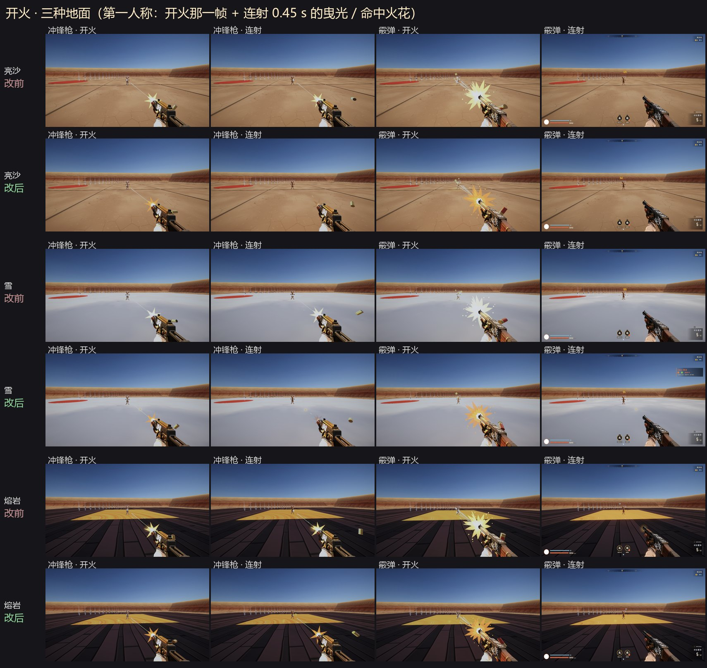

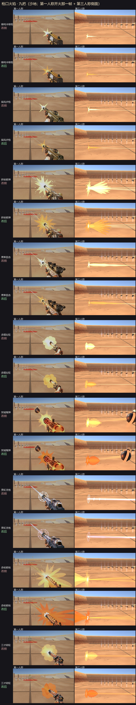

### A2 抛壳 —— 符合

哑光黄铜小圆柱，落地停住，和枪模同一种材质感。不改。

### A3 曳光 —— 符合

细而硬的一道，元素色，第一人称起始段加粗、远端按距离加宽（A 路上一轮的改动）。不发白、不糊屏。不改。

### A4 弹孔 / 焦痕 —— 小偏差 → 已改

- **问题**：焦痕上撒了两层噪点——`vnoise × 34` 的火星点和 `× 50` 的灰点；沙坑外一圈 `× 60` 的沙粒噪点。违背 ④。焦土的 Voronoi 龟裂是中尺度的，保留。
- **改法**（`fx_shot_textures.py`）：灰点删掉；火星点换成 5–7 块中尺度的余烬块（多边形，0.03–0.045 格宽），余热 0.7 → 0.55（橙而不白）；沙粒删掉，溅沙只靠几道放射沙痕。
- **改后**：

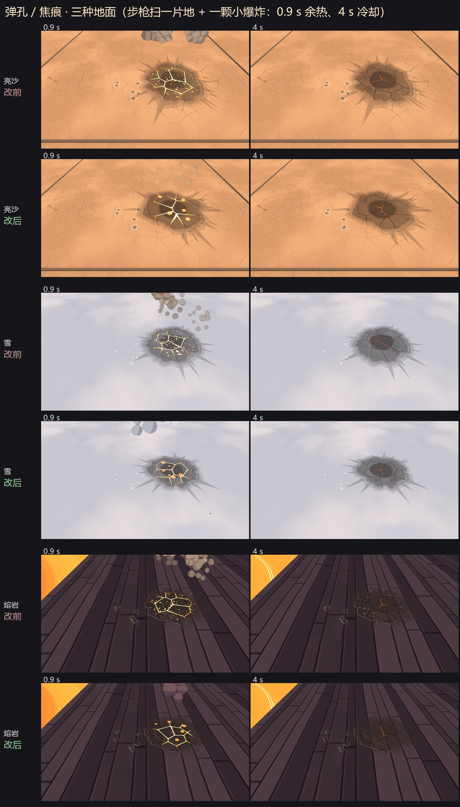

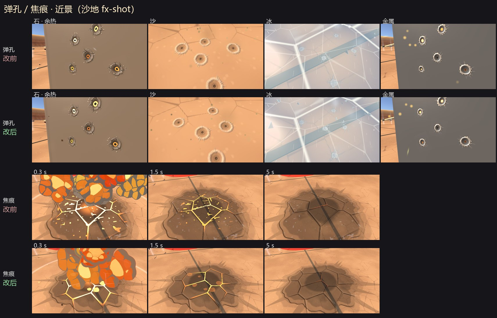

### A5 命中火花 —— 小偏差 → 已改

- **问题**：盾 / 甲 / 血肉三层的命中闪光是 0.38–0.48 m、混白 50–60% 的柔光球，近看是一团白雾罩在身上（`S10` 改前）。违背 ②④「高光要小、要硬」、⑦。
  弹着点（打在石头上）的尘是灰的 `0x8c8274`、碎屑近黑 `0x3b322b`，违背 ③「沙寺的尘是暖沙色」。
- **改法**：`EnemyHit` / `EnemyHitArmor` / `EnemyHitShield` 的闪光缩到 0.26–0.3 m、混白降到 35–40%；`Impact` 的尘和碎屑改走章节环境色（见 B1 的 `FxTone`）。
- **改后**：火花本身（拉丝、星点）不变，闪光只是一眨眼的小亮点。

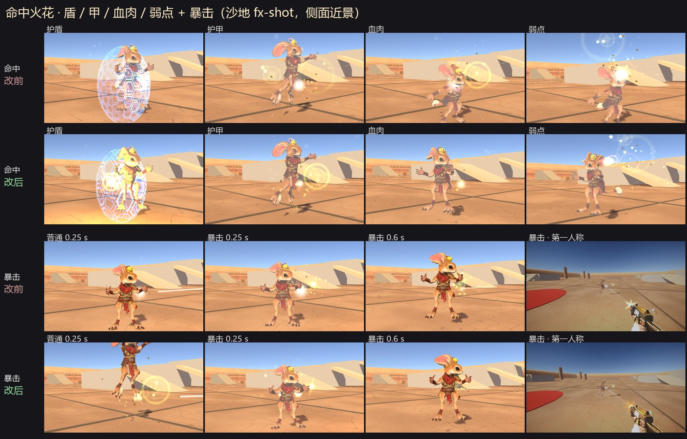

### A6 暴击 —— 符合

上一轮已经把星芒挪到轮廓外、闪光芯收到 0.26 m、连续暴击有上限；金色四角星 + 小金星是中尺度的硬形状，元素色表的「圣 / 金」。不改。

### A7 碎刃刀光 —— 不符合 → 已改

- **问题**：刀光是一张「内沿透明 → 七成处 0.42 → 外沿最亮」的渐变半透明面，没有起收锋，两头齐刷刷地截断；第三段侧看补宽时，两三个采样点会撑出一块四方形的半透明面片（`S11` 改前第 3 段判定帧）。
  刃口混纯白。违背 ①「一道月牙主形」、②、准准则第三节「刀光带墨笔起收锋、玩家刀光偏金」。
- **改法**（`BladeTrail.cs`）：
  - 横截面只画刀身扫过那块面靠刃口的四成：短短一段过渡到带身色（墨笔的边）、带身平涂、刃口暖白——两段色阶，读作一弯月牙，不再是一整张扇面；
  - 沿长度加墨笔起收锋：每一条刀光按采样点在条内的位置 `u` 收宽——起笔端（最老）收成尖、贴刀的一端略收，读作两头尖、中间饱满的一弯月牙；方形面片随之变成尖角；
  - 刃口混向暖白 `(1, .9, .66)`（偏金），刃口闪光缩小。紫色带身是碎刃的武器色，保留。
- **改后**：

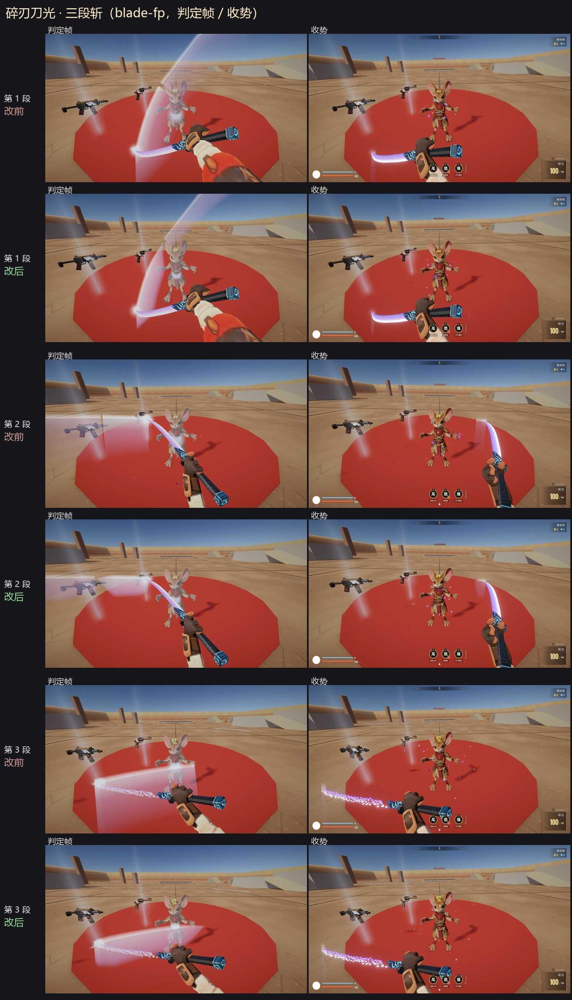

## B 路 · 爆炸 / 元素 / 状态 / 护盾

### B1 爆炸三档 —— 不符合 → 已改

- **问题**：
  - 序列帧每帧是 1 + 9 + 2 = 12 个小团，每个小团都有自己的白热芯，团与团之间压一道灰折缝；中、大档十几颗这样的粒子叠起来，近看是一片泡泡纸（`fx-shot` 焦痕近景最明显），
    0.6 s 时大档碎成一地小橙块。违背 ①「形状先于细节、一两个大形」、④。
  - 描边和冷却段是中性灰 `(0.17, 0.15, 0.14)`，烟是灰色 `0x8f8377` 的鹅卵石，沙地上一团灰；违背 ②「灰雾」、③「沙寺的尘是暖沙色、火的暗边是赭红」。
  - 起爆闪光是 1.2–1.6 × 半径的纯白柔光，中档就是 4 m 一团白；闪光灯把亮沙照出一大片白。违背 ②④「克制的光」。
- **改法**：
  - `scripts/unity/fx_blast_atlas.py`：火团 1 + 6 + 1、烟团 1 + 5 + 1，每团放大；热度一半按整簇算，一簇只有一个白热芯；法线噪声 0.22 → 0.06（每团干净的两段明暗），折缝减轻；
    烟团照祥云摆——顶上三个团头、两侧各一、底下收平。
  - `SF_FxToon`：火的深色一档往赭红偏，描边在火团还热的时候是赭红、冷成烟以后才是暖褐（原来总落到最冷的灰档），描边不再额外压低热度（原来每团外缘都降一档，一圈圈灰线）；
    烟的暗面偏冷、描边淡一半（几团叠在一起不读成鹅卵石的裂缝）。
  - `FxToon` / 材质：火团、火舌、发光件的 HDR 亮度 1.75 / 1.6 / 1.35 → 1.45 / 1.45 / 1.2。
  - `Explosion.cs`：外滚小火团少几颗、每颗大一点；中、大档的烟少一半、每团大三成，寿命短 15–20%（余韵快退场）；闪光柔光缩到 0.7–0.9 × 半径、混成主色；闪光灯 × 0.65。
  - **章节环境色**（新）：`FxTone` + `FxColor.Ground`。烟、尘圈、碎石写沙寺的颜色（暖沙 `0xc4a27a`、赭褐 `0x6e4c34`），
    发射时按当前章节换成同明暗的霜山蓝灰 → 冷白、熔火暗紫 → 紫褐。章节按场景名 `L1_ / L2_ / L3_`，其它场景按本局章节。弹着尘、熔金余韵、死亡的烟都走这一套。
- **改后**：沙地暖沙烟、雪地冷白烟、熔岩紫褐烟；火团读成三四个大团，描边是赭红而不是灰线。

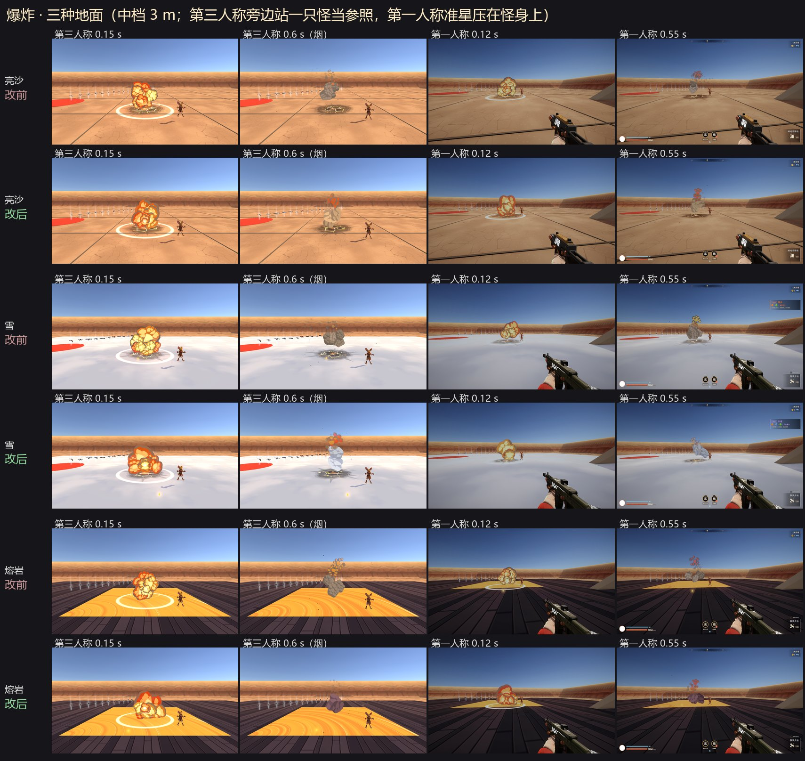

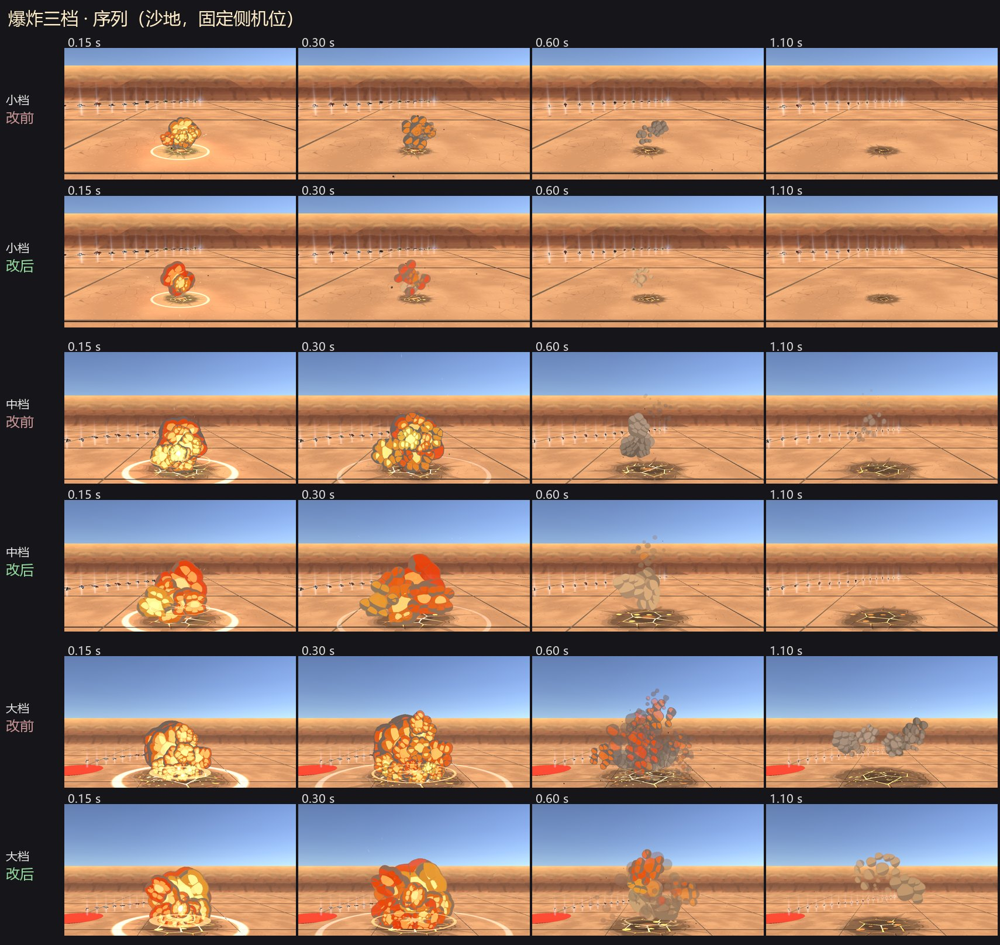

### B2 元素反应 —— 不符合 → 已改

- **问题**：`RxKit.Flash` 是 2.2–3.2 m 的纯白柔光（熔金 / 焚雷 / 封脉 / 崩解都用），闪光那一帧整个人被罩白；归墟的闪光球 + 白热核心按余波半径放大成 4–5 m 的白团；
  熔金余韵是灰石色的烟；闪光灯 6–11，亮沙上照出一大片白。违背 ②③④。
- **改法**：`RxKit.Flash` 尺寸 × 0.4、纯白改成主色混白 50%；归墟闪光球 0.45 → 0.2、核心 0.7 白 → 0.3 紫白；熔金余韵烟走章节环境色；四个反应的灯 × 0.6。爆闪星、卡通环、刻符印这些硬形状不动。
- **改后**：闪光那一帧敌人轮廓清楚，焚雷的金、归墟的紫都比原来认得出。

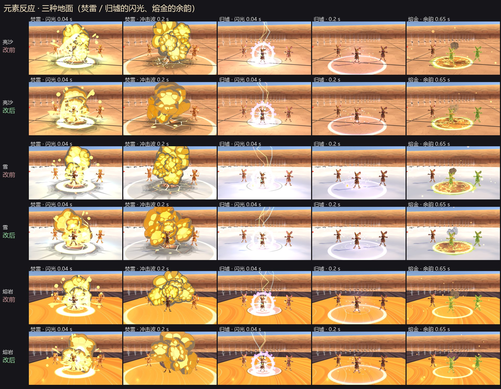

### B3 状态外观

- **灼烧 —— 符合**：卡通火纹、赭红边、身上炭火纹，形状和火舌一套。
- **感电 —— 符合**：上一轮已把电纹收细、染色收淡。
- **蚀化 —— 小偏差 → 已改**：HDR 酸绿 `(0.65, 1.7, 0.18)` 的斑边 + `(0.9, 2.2, 0.12)` 的轮廓光，整只刷成霓虹绿，比旁边的模型亮一截；`uv × 30` 的小泡是一层噪点；
  斑块按网格 uv 算，被图集岛缝切成一块块方块。改：斑块改用贴着身体的 3D 噪声（十几厘米一块、圆润），覆盖少一点；三段色——墨绿斑芯、鲜绿斑边、黄绿的泡；
  斑边 HDR 收到 `(0.48, 1.15, 0.14)`、轮廓光收到 `(0.5, 1.35, 0.1)`；泡少而大（`uv × 13`）、蚀液条纹粗一点。
- **眩晕 —— 小偏差 → 已改**：星尾的柔光点每秒 30 颗 → 12 颗。
- **减速（冰壳）—— 不符合 → 已改（残留小偏差）**：`uv × 26` 的细晶格 + HDR 白格边 + 格心闪点 + 白轮廓光 `(1.7, 1.95, 2.1)` + 近白染色 `0xdff5ff`，整只发白、像一层白色细裂纹。
  改：晶格放大到 `uv × 9`，每块晶面按格随机数 + 主光分亮面（淡冰蓝白）/ 暗面（冰蓝）两段，晶格边是一道深一点的蓝灰而不是亮白线；去掉闪点；
  覆盖 0.5–0.8 → 0.56–0.74；轮廓光改冰蓝 `(0.55, 1.15, 1.9)`；身上染冰蓝 `0x9fd2f2`；冰雾光点 10 → 4 颗 / 秒、冰晶闪点 5 → 2 颗 / 秒。
  残留：亮面朝主光时冰壳仍偏浅（这是冰本身的颜色，远处要和「冻住」读得出来）；冰晶块面还是在网格 uv 上算的，跨图集岛缝的地方会切直边——要彻底解决得给状态皮烘一套连续的 uv2，不在本轮范围。
- 改后：

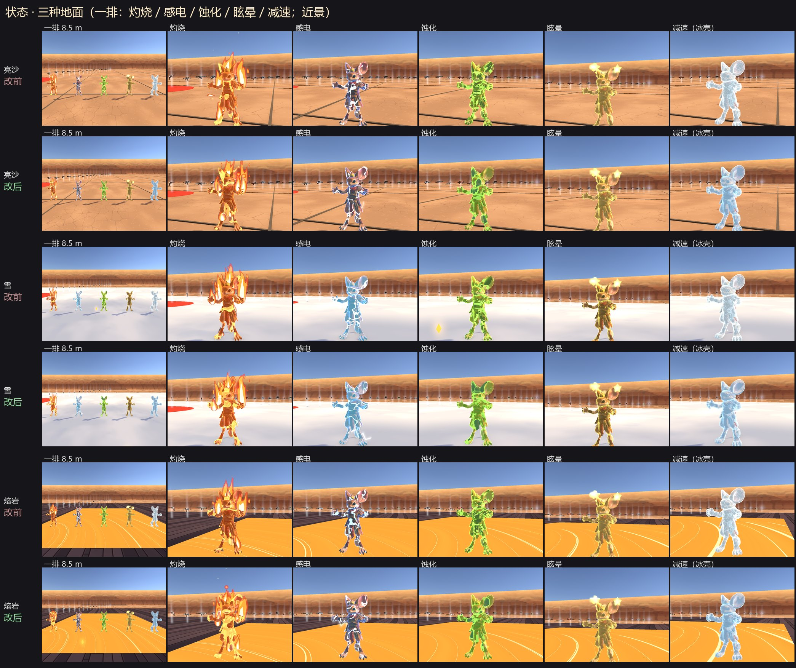

### B4 护盾 / 护甲

- **护盾球壳 / 破盾 —— 不符合 → 已改**：戈德堡多面体二次细分（150 个六边形 + 12 个五边形），一个人形身上的格子只有巴掌大，读成科幻的细网格；
  破盾那一帧格面闪白 + 破碎爆亮 2.4 倍，整个壳白成一个蛋，伴随的柔白闪光 1.5 m + 灯 6 把脚下照亮一片。改：一次细分（30 + 12 格）的大龟甲格（中尺度纹样，格边也粗了），
  涟漪带和命中格的角宽按格距放大；命中格、破盾的闪白收一档（亮的是格边，格面只淡淡一层）、破碎爆亮 2.4 → 1.6 倍；伴随闪光 1.5 → 0.8 m、灯 6 → 3.5。
- **破甲 —— 小偏差 → 已改**：柔白闪光 1.4 → 0.8 m、混白 60% → 35%，灯 6 → 3.5（脚下不再一圈亮黄）。金色爆闪星、甲片、火花不动。
- 改后：

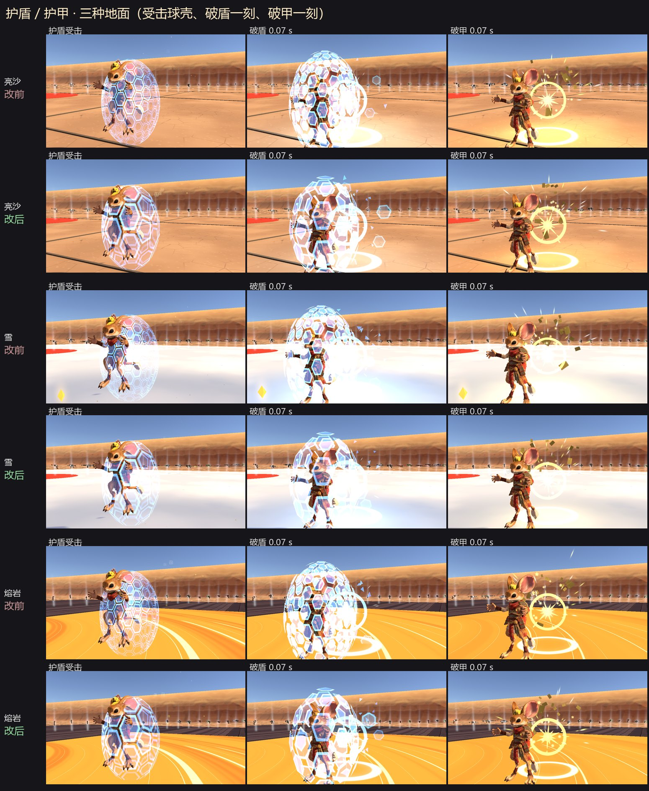

### B5 火舌 —— 符合

S 形往上翻、顶端断出小火团、赭红暗边、白热芯小（上一轮已收），和准则第三节的「火」逐字对得上。不改。

### B6 出生 / 死亡

- **出生显形 —— 小偏差 → 已改**：显形前沿是 HDR 敌人色 × 4.2 + 白热底，0.3 s 时整只怪是白的；光墙是白金色的柔光柱。前沿收到 × 2.8 + 一点白（只是一道亮边），光墙 × 0.6。
  三章主题法阵是 C 路的，不动。
- **死亡迸散 —— 小偏差 → 已改**：白热闪光 1.5 → 0.85 m；深灰柔烟（`Smoke`）换成实心卡通烟团（`ToonSmoke`）+ 章节环境色。元素迸散不动。
- 改后：

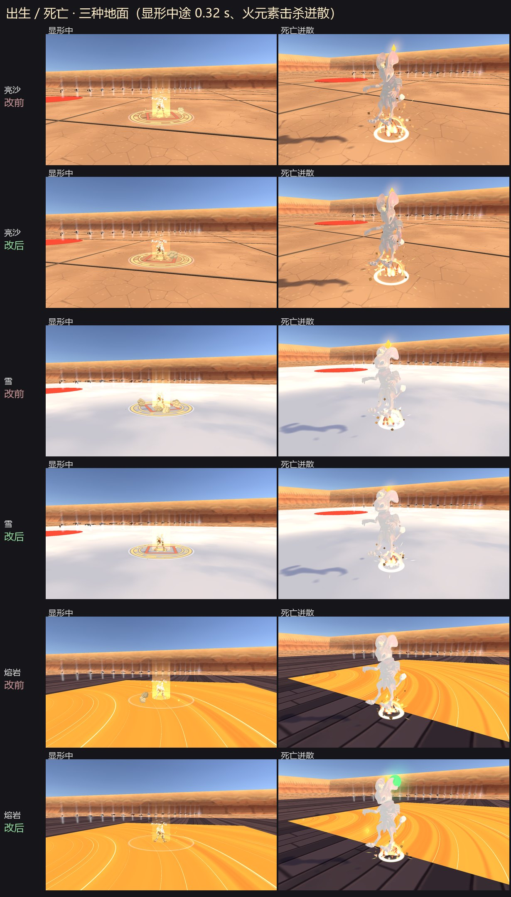

## C 路 · 首领 / 怪物专属、预警、出生法阵（2026-10-29 补审）

C 路的整改在提交 `124a6721` 里就完成了（`SF_FxSurge` 三阶、`SF_FxSigil` 粗线少元素、预设换成 B 路的卡通序列帧）。本节按清单补齐结论，依据是改前 / 改后对照图 [C/style-pass.jpg](C/style-pass.jpg)，以及 `boss-intro`、`gallery`、`fx-boss` 三套的重拍图。

| 特效 | 审查结论 | 依据（清单条） |
|---|---|---|
| 出生法阵（沙印 / 冰晶 / 火卦） | 不符合 → 已改：符合 | 改前：细线、多元素，底下一层噪点霜花（④）。改后：线粗、元素少，用墨边托线，主色是朱红方印、鎏金日纹 / 火眼（§2.3）。缩到 25% 仍认得出印、冰、卦（①） |
| 熔浆柱 / 熔溅 | 不符合 → 已改：符合 | 改前：连续渐变加细熔流纹（②④）。改后：暗紫褐壳、铜橙、金黄三阶，熔流粗而少，烟改紫褐团块（③）。柱子周围还有几颗小金点，量很少，不算问题 |
| 砸地 / 日轮炸亮 | 不符合 → 已改：符合 | 改前：发光团加灰尘雾，日轮炸亮时整片白（②）。改后：卡通爆闪星、粗冲击环、贴地尘团，灯光减半；爆闪亮芯小、带主色 |
| 水柱 / 水幕 / 漩涡 | 小偏差（保留） | 改后是深浅两阶水身加白沫块，形状读得出（①）。但在亮沙上，水幕和漩涡的浅阶偏灰白，和沙地的明度太接近（②⑤ 边缘）。这只出现在旱魃的抽泉和吞吸里，下面有赤红预警托着，不影响读招。以后改：浅阶往青绿推一档，和沙地拉开色相 |
| 首领登场 / 招式 / 倒下 | 符合 | 四个首领逐招都是「蓄 → 爆 → 余韵」，余韵收短（熔铜贴花 5–8 s，⑥）。日轮扫射去掉了逐帧闪光灯，魔将落地去掉了叠在一起的细白环 |
| 地面预警 | 符合 | 统一危险色（赤红，第三章品红）加暗衬边，亮边按屏幕像素保底，三种地面上都读得出（⑤） |

## D 路 · 环境氛围（2026-10-29 补审）

D 路的自查整改在提交 `fb304670` 里完成，12 关改后的拼图在 [D/](D/)（`envfx_<关>.jpg`，每关分主景第一人称、俯瞰、火盆 / 灯笼、水面 / 熔岩、扰动几格）。

| 特效 | 审查结论 | 依据 |
|---|---|---|
| 熔岩面（3-1 / 3-2 / 3-4） | 符合（有一处小偏差） | 暗壳、亮裂缝、热区三阶分明，板块是中尺度的（④）。小偏差：3-2 第一人称近处，熔瀑底下那一片亮黄占了画面下方约四分之一（② 边缘），但不发白，敌人的暗剪影在上面反而更清楚（⑤），所以不改 |
| 水面 / 白沫（1-4、2-3、2-4） | 符合 | 卡通三档水色，白沫只留贴岸一圈；俯视时不再大片发白，也没有细碎白点（自查时已改） |
| 流沙 / 沙帘（1-2、1-3） | 符合 | 螺旋沙纹是中尺度的；沙帘不再从镜头上擦过，沙雾团缩小了（自查时已改，⑤） |
| 火盆 / 火坛 / 灯笼 | 符合 | 用 B 路同一套卡通火舌，点光按画质限数（⑧），灯笼的冷光晕克制 |
| 空气粒子（浮尘 / 飘雪 / 余烬） | 小偏差（保留） | 数量少、动得慢，符合「只是氛围」。但飘雪在 1080p 第一人称下只有一两个像素大，偏「细碎颗粒」（④ 边缘）。量很少，不抢读感，先不改；以后可以把雪片放大到 3–4 像素、数量再减三成 |

## 验证

**拼图**：`docs/art/review/fx-polish/style/` 共 12 张（S1–S12），每组上一行改前、下一行改后。改前是同一会话里用审查前的代码拍的
（fx-style 三种地面、fx-shot、blade-fp 在 HEAD 上重拍；fx-blast 用 B 路上一轮的改后截图），改后是全部修正后的最终版本。重拍：

```
bash scripts/unity/bridge.sh playtest fx-style      # sty_*（三种地面）
bash scripts/unity/bridge.sh playtest fx-shot       # fxa_*
bash scripts/unity/bridge.sh playtest blade-fp      # blade_fp_*
bash scripts/unity/bridge.sh playtest fx-blast      # fxb_*
python scripts/unity/fx_style_sheets.py <改前截图目录> <改后截图目录>
```

**回归**（全部通过）：fx-style、fx、fx-shot、fx-blast、fx-elements、blade-fp、weapons、desert、frost、inferno、arena。
desert 第一次跑有两项 AI 站位不合格（蝎尾弩卫 14 s 没找到视线、沙魇 18 s 没潜沙），和特效无关（这两只的 AI 不读任何改动过的特效代码），原样重跑一次全过；
EditMode `Fx|FxStyle|FxShot|BladeFirstPerson` 共 38 + 29 个全过（新增 `FxStyleTests`：章节环境色的冷暖 / 明暗、爆炸烟尘走章节色且不是灰、闪光不超过 1.3 m 且不是纯白）。

**性能**（`playtest fx` 压力项：8 只敌人着火感电 + 暴击连射 4 s + 3 次爆炸；同一会话、同一台机器先在 HEAD 上跑改前，再跑改后）：

| 画质 | 同屏粒子峰值 改前 → 改后 | 平均帧时间 改前 → 改后 |
|---|---|---|
| 高 | 396 → 382 | 12.2 → 11.4 ms |
| 低 | 193 → 193 | 11.1 → 11.0 ms |

爆炸的火团、烟团少了三到四成，护盾网格从 162 格降到 42 格，粒子峰值和帧时间都没有变差。所有改动都在原有的 FxBudget / 画质密度里，没有新增不受预算管的发射。
（这一轮帧时间整体比特效打磨约定里记的 9.5 / 8.3 ms 高，是编辑器同时在给别的会话排队、截图负载不同，改前改后是同一条件下对比的。）

## 遗留项（2026-10-29 已处理）

上一轮登记的三处遗留：

- **蚀蛊灯的灯笼弹**（②⑤）：已改。
  - 原来是一团向白混的发光球加 4 倍光晕，第一人称开火时整片半透明绿罩在屏幕下方。
  - 现在是漆框灯笼：上下两道漆圈、两道贴着灯身的竖向漆环拼出四根骨、顶上提纽（暗边），配浅绿灯身和一层淡淡的鲜绿光。光晕收到 2.2 倍。
  - 新增「近镜头淡入」（`ProjectileVisualRecipe.nearFade`）：我方弹离镜头 2.6 m 以内时，从 0.45 倍大小、光层淡着长到全尺寸。
  - `fx-shot` 的蚀蛊灯第一人称截图里读得出灯笼大形，屏幕下方不再是一片绿雾。
- **碎刃刀身的光点**（④）：已改。
  - 原来归位闪是每块碎片各亮一颗 3 cm 的小光点，最多 128 颗。
  - 现在刀身分 6 段，每段合成一颗 6–9.5 cm 的光点，落在这一段亮起碎片的加权中心，整把刀仍是一段段闪过去。
  - `blade-fp` 归位时最多 6 颗，碎片 0.55 s 全部归位；套件的下限相应从 5 颗改为 3 段。
- **冰壳的 uv 岛缝**（④）：已改。
  - 导入时给没有毛发配置的角色也烘 UV2 = 绑定姿势位置（`FurBake.ApplyRestPose`，和毛发用的是同一套）。
  - 状态皮的冰晶切面、蚀斑和泡改按它算 3D 晶格和 3D 噪声，贴在皮肤上：不再被图集岛缝切出直边，转身时蚀斑也不会在身上滑。
  - 没有这份数据的网格（静态件）退回网格 uv。
  - 角色模型要重新导入才有 UV2：Art Sync 按导入戳记 `:rest1` 自动重导。

验证说明：这三处在一台装有透明加密（DLP）的机器上做，Unity 自己写出的材质会被加密、读回失败，`fx-style` 的状态皮截图因此没拍成。编译、787 个 EditMode 测试，以及 `fx-shot`、`blade-fp` 里和上面两条直接相关的检查都通过了。冰壳要在协作者的机器上补跑一次 `bash scripts/unity/bridge.sh playtest fx-style` 看三种地面上的效果。

## 收尾一轮（2026-10-29）：冰爆、冰壳、元素爆炸、旱魃的泉水、鲲鹏倒下余韵

战斗审阅图集收口审查后还剩几处不合准则（问题清单 #14–16，以及审查里顺带确认的两处），这一轮全部改掉。拼图 S13–S17
（`python scripts/unity/fx_style_sheets.py <改前> <改后> --final <改前图集> <改后图集>`；改前是同一会话里先用改动前的代码拍的
`playtest fx-style-cold` 和改动前的 gallery 截图）。

| 特效 | 审查结论 | 问题（清单条） | 改后 |
|---|---|---|---|
| FX3 冰爆 FrostNova（#14） | 不符合 | ②④ 一团柔边白粉雾 + 白冷环 + 白光墙，亮沙 / 雪上一大片白，读不出冰晶 | 符合 |
| 状态 · 减速冰壳（#15） | 小偏差 | ②⑦ 整只读成一层光滑的浅冰蓝，大切面分不出明暗 | 符合 |
| 鲲鹏倒下 · 余韵（#16） | 不符合 | ② 冻雾糊屏；鲲沉水时还有录制机位跟到水下 | 符合 |
| 元素爆炸（雷 / 蚀 / 金 / 紫 / 冰） | 不符合 | ③ 只有火的色阶，元素色传进去混成带赭红描边的泥色火团 | 符合 |
| 旱魃的水柱 / 水幕 / 泉床喷气 | 小偏差 | ②⑤ 灰白半透明的圆筒，亮沙上读成灰柱子 | 符合 |

### E1 冰爆 —— 不符合 → 已改

- **问题**：FX3 写在风格准则之前，主体是一蓬往外翻的柔边白粉雾（Powder）+ 贴地不散的冷雾 + 1.2 × 半径的冷白柔光球，
  再加白色冷环和一圈竖直光墙、白拉丝、雪花闪粒；离地近时还铺一块 10 s 的白色羽状霜纹。亮沙上是一大片白（②），细碎闪粒和霜纹噪点（④），
  完全没有准则里「块面清楚的冰晶多面体」的大形（①）。冰河豚自爆、fx 通用冰爆、鲲 → 鹏化形、鲲 · 吐冰的冰块落地、MatriarchNova 都是它。
- **改法**：
  - 主形换成真正的低多边形冰晶（新 `FrostBurst` + 新着色器 `SF_FxCrystal`，材质 `M_Fx_Crystal`）：三种程序冰晶（长六棱双尖、粗五棱、扁四棱，侧面四边形的对角线不画），
    不透明卡通冰——每个面按主光分三阶（亮面近白 / 主色冰蓝 / 暗面蓝灰），面与面按面法线哈希错开一点，棱边一道蓝灰暗线；
  - 时间结构：一簇 5–8 根冰晶从爆心「长」出来（0.08 s，带过冲，蓄）→ 0.1 s 整簇崩开、和一把碎冰一起往外翻飞（爆）→ 落地弹一下，
    最后四成寿命里按面哈希一面一面碎掉（余韵），0.65 s 内全部退场；冰晶个头跟着爆炸半径走（0.62 r，≤ 3.2 m），远处读得出炸了多大；
  - 陪衬：一记硬边冰晶星芒（0.1 s）、冰蓝卡通粗环 + 底下一圈冰蓝实心团块（ToonDust，亮地面上托得住环）、两三团实心冷白雾团（暗面蓝灰）、几片中尺度冰碴；
    冷光强度收到原来的四成；
  - 去掉：白粉雾、贴地冷雾、冷白柔光球、白拉丝、雪花闪粒、白冷环 + 光墙、霜纹贴花；
  - 预算：块数乘画质密度、过同屏粒子预算（一块冰晶算一颗）、全场同时存在的上限高 64 / 中 48 / 低 32，满了不再生成；离镜头 1.6 m 内的面一块块掉（贴脸自爆不挡屏）；
  - 碎冰 FrostShatter 的白粉雾同样换成一两团实心冷白雾团，闪光柔光缩小。
- **改后**：三种地面上都是一簇冰蓝的冰晶炸开，亮面白只在朝光的切面上；第一人称 12 m 外读得出大形。

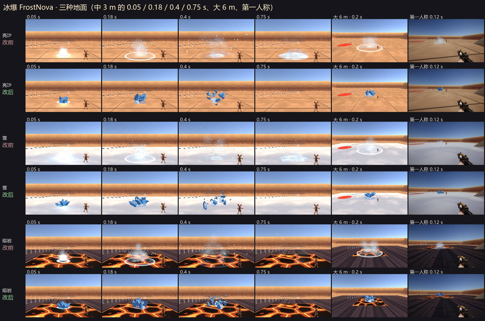

### E2 减速冰壳 —— 小偏差 → 已改

- **问题**：上一轮已把细晶格放大、去掉闪点，但冰壳仍是「两段色阶 × 连续的受光渐变」，朝光那一侧大半晶面落在亮面，整只读成一层光滑的浅冰蓝；
  着色器里的颜色常数是按显示色写的，线性空间里显示出来偏浅一大截；冰壳覆盖只有 0.56–0.74，身体的暖色从冰下透出来，和冰蓝混成浅灰白。
- **改法**（`SF_FxStatusSkin` 冰壳段、`StatusFx`）：三段硬色阶——只有最朝光的三四成晶面是亮面白，背光的一半是深冰蓝暗面，其余是冰蓝主色；
  晶格边一道蓝灰暗线、加粗一点；颜色按线性空间重新取；覆盖提到 0.76–0.9；身上的染色从浅冰白换成冰蓝，冰蓝轮廓光收一档。
- **改后**：冰蓝为主，切面一块块读得出，亮面白只是点缀。

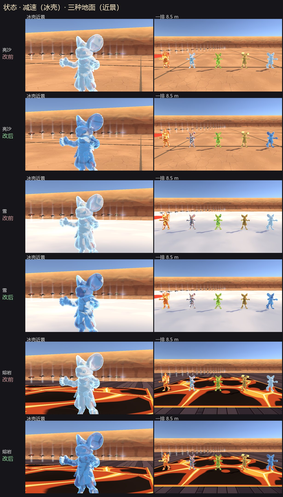

### E3 鲲鹏倒下的余韵 —— 不符合 → 已改

- **查因**：两个原因都有，取决于鲲鹏死在哪个形态。
  - 鹏倒在冰面上（收口审查那次）：旁观机位在冰面上方、看鹏落点的地面，整幅浅蓝白来自余韵挂的 6 s 冻雾——霜纹贴花浓度 1.1 的羽状白霜 + 近白的冷雾团（同时约 15 团），
    铺在本来就是浅色的冰面上一大片白，是特效糊屏。
  - 鲲倒下沉进冰窟（本轮第一次重拍时遇到）：死去的首领按模型包围盒取景，鲲沉到水下，旁观机位跟着落到水面以下，拍出一整幅水下的青色，是录制机位的问题。
- **改法**：
  - `FrostFogFx`（所有冻雾一起受益）：霜纹浓度 1.1 → 0.6，冷雾团从近白换成冰蓝灰，数量少三成五；鹏砸冰面那一下的冰爆不再铺霜纹（见 E1）；
  - `GalleryRecorder`：对象在水面以下时看水面那一点、机位抬到水面以上（L8 水体和鲲鹏冰窟都认）。
- **改后**：见 S17 鲲鹏一行（这次重拍是鹏倒在冰面上：余韵那一格场景清楚，只剩淡淡的冻雾）。

### E4 元素爆炸 —— 不符合 → 已改

- **问题**（截图确认）：B 路的卡通爆炸只有火的色阶——`SF_FxToon` 的火团把粒子色当主色，亮芯往黄推、暗边是主色²往赭红偏、冷下来是暖褐烟；
  预设里火团还在「亮黄 ↔ 主色」之间随机取色。雷的蓝白进去是黄绿芯 + 赭黄描边的泥团，蚀是黄绿 + 赭边，紫是粉紫芯 + 褐边，冰是青黄泥团。
- **改法**：
  - `Fx.Explosion` 按调用方传的颜色认元素（`Fx.BlastThemeOf`：先认元素色表、冰霜色板、反应色、雷 / 光束 / 护盾的蓝，其余按色相），所有调用方不用改：
    火 / 无元素 / 沙 / 熔岩照旧；雷、蚀、金（焚雷）、紫（归墟、碎刃）走元素版；冰不进火团，分流到 E1 的冰爆；
  - `SF_FxToon` 火团模式按粒子色的色相整套换亮芯 / 暗边 / 烟（暖色 = 火，原算法一字不差）：蚀 = 黄绿芯、墨绿边，雷 = 白芯、靛蓝边，紫 = 淡紫芯、深紫边；
    暗边和火的赭红一样是「亮的深色」，冷下来的团块不压成一大块深色；
  - `Presets/ExplosionElements.cs`：三档火爆炸逐层改出四套——火团和爆闪星的亮芯换元素亮芯，烟换元素暗边色（雷、紫的烟少六成），
    火星换成元素自己的小件：雷 = 电弧碎纹 + 雷裂光（另劈两轮伸出火团外的折线电弧），蚀 = 黏团，金 = 小金星，紫 = 灵光；炭渣只有火有，蚀的焦痕换蚀液溅痕；
  - 顺带：没有元素的敌方爆炸弹按弹体颜色认元素——狌狌的雪块落地原来在冰碴里炸出一团火，现在是冰爆。
- **改后**：

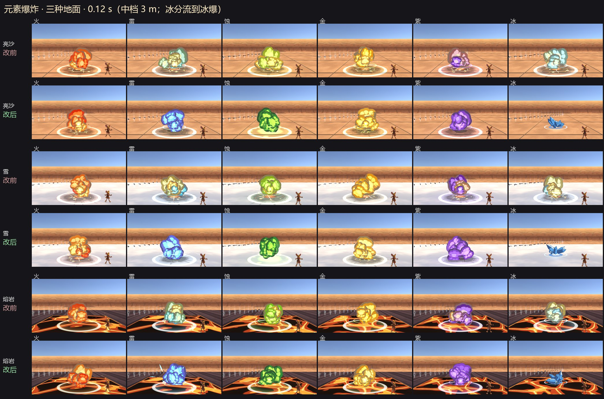

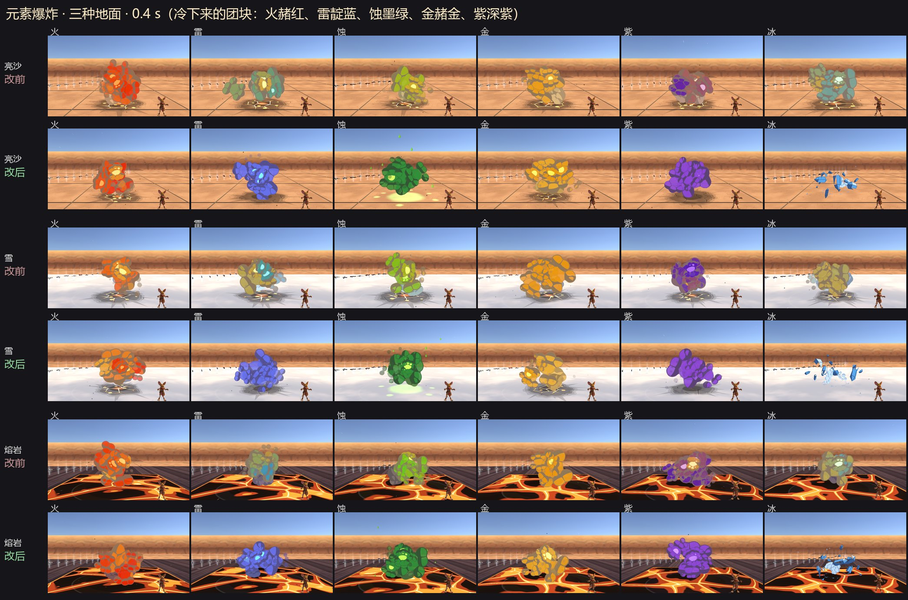

### E5 旱魃的水 —— 小偏差 → 已改

- **问题**：二阶段泉床喷气是灰白（0.72, 0.74, 0.72）的半透明汽柱 + 加法白汽，登场破泉的水柱 / 水幕是浅青半透明；半透明的青绿叠在亮沙上混成灰白（C 路补审登记）。
- **改法**：新涌流类型 `SurgeKind.Spring`（`SF_FxSurge` 模式 4，其余模式输出不变）：深青水身 / 泉水主色 / 白沫块三阶，几乎不透明，轮廓一圈白沫亮边，
  颜色取 1-4 水面的泉水色；`Fx.SpringSpout` / `Fx.SpringSplash` 配实心白沫团、泉水色水珠、浅青拉丝水花，柱脚一圈泉水色水花团 + 白沫涟漪圈。
  泉床喷气改成泉水喷柱，登场破泉、倒下时泉心那一下都走它；北冥（鲲鹏）的海水不变。
- **改后**：见 S17 旱魃一行和 `fx-boss` 的 `fxboss_spring_*`。

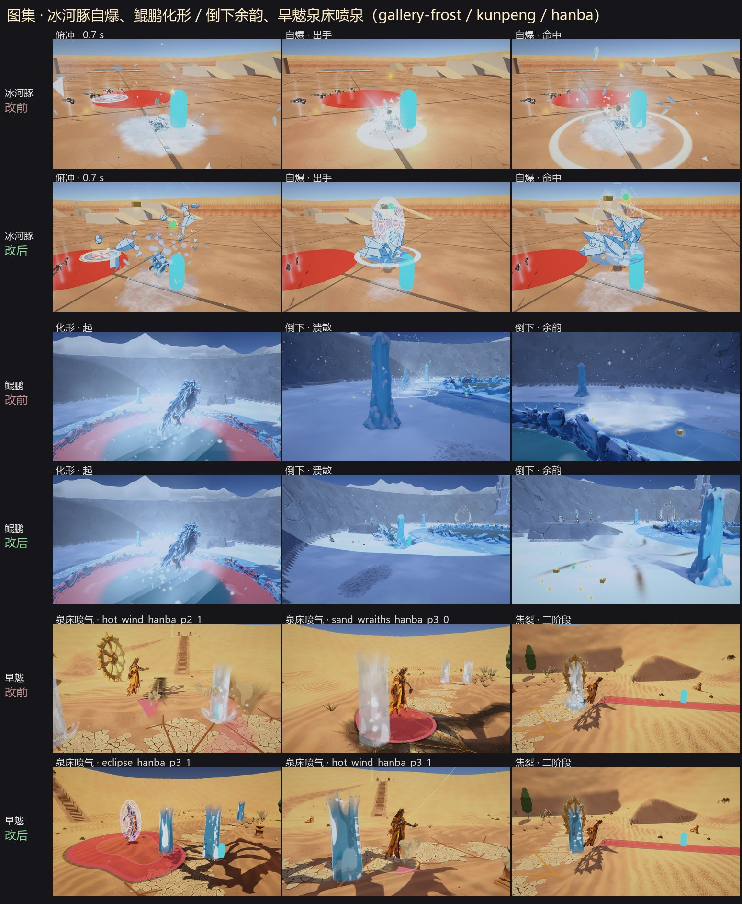

### 验证（收尾一轮）

**回归**（全部通过）：fx、fx-elements、fx-style、fx-style-cold、fx-boss、boss-kunpeng、boss-hanba、frost、desert，
以及 gallery-kunpeng / frost / hanba / desert；EditMode 全量 791 个全过（新增 `FxStyleTests` 四条：元素色 → 爆炸元素的映射、元素爆炸没有火的炭渣火星且亮芯 / 烟是元素色、
冰爆没有白粉雾 / 柔光 / 细碎闪粒 / 冷环光墙且 0.65 s 内交代完、四个特效着色器编译无错）。新着色器 SF_FxCrystal、改过的 SF_FxToon / SF_FxStatusSkin / SF_FxSurge 编译无错（同一条测试查）。

**性能**（`playtest fx` 压力项，同一会话、同一台机器，先在改动前的代码上跑、改完再跑）：

| 画质 | 同屏粒子峰值 改前 → 改后 | 平均帧时间 改前 → 改后 |
|---|---|---|
| 高 | 384 → 383 | 11.7 → 11.9 ms |
| 低 | 189 → 192 | 11.5 → 11.4 ms |

压力项本身是火爆炸 + 状态，元素爆炸、冰爆不在里面；冰爆的冰晶另算：一次 3 m 冰爆 15–16 块（`fx` 套件），同屏上限高 64 / 低 32，都过 FxBudget。
帧时间整体比约定里的 9.5 / 8.3 ms 高是编辑器同时给别的会话排队、截图负载不同（上一轮就是 11–12 ms），改前改后同条件下持平。

**重拍**：gallery-frost / kunpeng / hanba / desert 和 fx 通用特效组（fx-blast、fx-frost 等）已重拍，`python scripts/unity/combat_gallery.py` 更新了总览页，问题清单 #14–16 改为已修，新增 #17–20。

### 遗留

- **鲲沉进冰窟时的余韵机位**：GalleryRecorder 已经会把水下的机位抬到水面以上，但本次重拍鲲鹏是以鹏的形态倒在冰面上，鲲没顶的那种死法没有再拍到，下次图集重拍时留意那一格。
- **鲲 → 鹏化形那一下整幅冷白**：那是化形演出有意涌满的冰雾（1.2–2.6 s 遮住换模型），不是冰爆；冰爆本身已经换成冰晶。要不要收薄属于演出设计，本轮没动。
- **北冥（鲲鹏）的水柱 / 水墙**：仍是 SurgeKind.Water 的浅青半透明，在冰窟深色背景里读得出，没有像月牙泉那样在亮沙上发灰，本轮不改；以后要统一可以给北冥也开一套 Spring 式的不透明三阶。
- 冰晶是程序网格，不需要美术资产；要更讲究可以请美术出 3–4 个手绘的冰晶碎块（低多边形、带切面配色），替换 `FrostBurst.BuildCrystal`。

