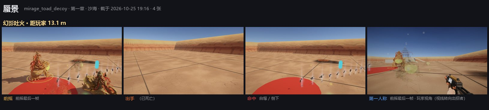

# Unity 战斗演出审阅图集

生成于 2026-10-25 19:27。浏览器打开同目录的 [index.html](index.html) 体验更好（点图放大、← → 翻页）。

每只怪 / 每个首领一张拼图：一行一个招式，四格依次是 **前摇**（预警最满的那一帧）、**出手**、**命中**（没打中则为收招）、**第一人称**（前摇最后一帧的玩家视角）。第三人称旁观机位里的青色胶囊是玩家站位。

重新生成：`bash scripts/unity/bridge.sh playtest gallery-<desert|frost|inferno|hanba|kunpeng|warlord|qilin>`、`playtest boss-intro`、`playtest fx`，然后 `python scripts/unity/combat_gallery.py`。

## 截图说明

- 三章普通怪都在测试场（TestArena）截：沙地、红色刷怪台、悬浮的武器架是测试场的东西，不是本章地形（红色圆台不是预警，别和红 / 橙色预警混看）；首领在各自的真实关卡里截。
- 普通和精英同时刷在刷怪台上，冰鲸、玄冰巨蟹这类大体型的两只会互相穿插——是测试摆位，不是游戏问题。
- 第三章模型暂缓，3-3 / 3-4 场地里的方块和浅色板是白盒占位；场地柱子密，个别旁观机位被柱子挡住。
- 「命中」= 出手后玩家第一次挨的一下（4 点以上，跳伤不算）；几只怪同时出手时可能记到别的怪头上。没打中就拍收招；辅助招（施法、换位、护甲）第三格是出手后 0.7 s 的「效果」。
- 「第一人称」格：眼睛位置不动、视线临时转向出招者（拍完还原），看的是玩家正看着它时预警读不读得出来。
- 第二、三章专属特效（FX3 abb8842a、FX4 26ea0002）提交之后才截的第二、三章普通怪；各图标题里有截图时间。

## 问题清单

| # | 严重 | 归属 | 对象 | 问题 | 见图 |
|---|---|---|---|---|---|
| 1 | 高 | 物理 / 击退 | 冰甲旋龟（第二章） | 旋壳撞飞玩家后，玩家视角一度落到地面以下：第一人称里地形消失、能看到地面网格条的背面衬在天空上，旁观机位里玩家替身也不见了；约 0.6 s 后才回到地面（这段时间测试套件没有挪玩家）。需单独复现确认是击飞把角色控制器推进了地面。 | [frost-xuangui](frost-xuangui.jpg) |
| 2 | 高 | 预警看不清 | 鲲鹏（2-4） | 鲲 · 吞吸的预警是白色半透明面 + 白描边，铺在白 / 浅蓝冰面上几乎看不出，第一人称只剩一条淡白边；吐冰、扇翼狂风的前摇最后一帧在第一人称里看不到任何地面预警。冰原场景的预警建议换成高饱和冷色（青 / 品红）描边 + 填充。 | [kunpeng-boss_kunpeng](kunpeng-boss_kunpeng.jpg) |
| 3 | 中 | 预警看不清 | 旱魃（1-4） | 日轮扫射、旱风、焦裂的预警都是白色细描边 + 很淡的白填充，在亮沙地上对比度低；第一人称里扇形 / 长条只看得出一条细线，离得 13 m 时更难分辨范围。 | [hanba-boss_hanba](hanba-boss_hanba.jpg) |
| 4 | 中 | 预警看不清 | 火麒麟 · 焚身（3-4） | 麟火扫象限、火云雨的前摇最后一帧在旁观机位和第一人称里都看不到地面上的象限 / 落点预警（只看得到麒麟本体），可能是预警被熔岩地纹盖住或画得太晚，需确认。 | [qilin-boss_qilin](qilin-boss_qilin.jpg) |
| 5 | 中 | 特效缺失 | 元素曳光（通用） | fx 套件这次不合格 1 项：「Shock 开枪后没有画出曳光」——雷元素的曳光没画出来（图里雷 · 侧面那张是 18:40 旧图）；火、蚀两种曳光在侧面图里都是同样的一条细黄线，看不出元素区别，第一人称里几乎看不到曳光。 | [fx-tracer](fx-tracer.jpg) |
| 6 | 中 | 可读性 | 熔心魔将（3-3） | 魔将本体是暗红黑配色，3-3 熔铸坊整体也是暗红打光，11–14 m 外只剩剪影，前摇动作（举刃、蓄冲）在第一人称里几乎读不出来；招式预警是浅米色，倒还看得见。 | [warlord-boss_warlord](warlord-boss_warlord.jpg) |
| 7 | 中 | 可读性 | 沙魇（第一章 / 旱魃召唤物） | 本体颜色和沙地几乎一样，测试场和 1-4 鸣沙山里远处都很难发现；潜沙突袭的落点预警是淡黄细圈，在亮沙上也偏弱。伏击怪可以藏，但出招前的预警需要更醒目。 | [desert-sand_wraith](desert-sand_wraith.jpg) [hanba-sand_wraith](hanba-sand_wraith.jpg) |
| 8 | 中 | 特效 | 三青鸟（第二章） | 冰羽扇射的冰羽是大块不透明的白色扁三角片，近看像纸片，缺少冰的透明感和发光；命中格里五片冰羽插在地上很突兀。 | [frost-qingniao](frost-qingniao.jpg) |
| 9 | 中 | 玩法 / 关卡 | 旱魃（1-4） | boss-hanba 套件这次有两项不合格：站在月牙泉浅水里，日晒判定没认出水（在水里 False），浅水里叠层速度和空地一样（应减半）。不是图集套件引入的，顺带记录。 | [hanba-boss_hanba](hanba-boss_hanba.jpg) |
| 10 | 低 | 特效 | 跳鼠刀兵 / 沙魇（第一章） | 交叉斩 / 交叉爪击的刀光很淡很细，出手帧在沙地上几乎看不到 X 字刀光，近战出手缺少一下明确的视觉重音。 | [desert-jerboa_blade](desert-jerboa_blade.jpg) [desert-sand_wraith](desert-sand_wraith.jpg) |
| 11 | 低 | 特效 | 状态外观（通用） | 五种状态主要靠整体染色区分（橙 / 紫 / 绿 / 黄 / 蓝），感电和减速在近景里几乎没有粒子（电弧、冰晶）；第一人称 15 m 外只能靠颜色分辨，减速和感电的蓝紫色容易混。 | [fx-status](fx-status.jpg) |
| 12 | 低 | 演出 | 鲲鹏（2-4） | 倒下演出偏短：被击杀后 1.5 s 鹏还在下坠，3.5 s 时场上已经什么都不剩（没有残骸 / 落羽 / 冰面余波），和旱魃、魔将、火麒麟的倒下演出相比收得太快。 | [kunpeng-boss_kunpeng](kunpeng-boss_kunpeng.jpg) |

招式表里有、这一轮没截到的招式：第二章 · 冰原 九尾狐巫 · 狐火；第二章 · 冰原 三青鸟 · 歇脚；第三章 · 火狱 炮仗傀儡 · 哑炸倒地；第三章 · 火狱 熔铜匠 · 裂锅；第三章 · 火狱 马面狱卒 · 重拳；第三章 · 火狱 变脸傩巫 · 碎面；第三章 · 火狱 火鼍 · 陆上扑咬

## 一、首领登场演出

**旱魃 · 1-4 鸣沙山月牙泉** `hanba` · 8 张 · 截于 2026-10-25 19:07

**鲲鹏 · 2-4 北冥** `kunpeng` · 8 张 · 截于 2026-10-25 19:13

**熔心魔将 · 3-3 熔铸坊** `warlord` · 8 张 · 截于 2026-10-25 19:14

**火麒麟 · 3-4 祝融殿** `qilin` · 8 张 · 截于 2026-10-25 19:15

## 二、首领招式 · 旱魃（1-4）

**旱魃** `boss_hanba` · 59 张 · 截于 2026-10-25 19:09

**邪飞天** `apsara` · 5 张 · 截于 2026-10-25 19:09

**沙魇** `sand_wraith` · 12 张 · 截于 2026-10-25 19:09

**蝎尾弩卫** `scorpion_archer` · 4 张 · 截于 2026-10-25 19:09

## 二、首领招式 · 鲲鹏（2-4）

**鲲鹏** `boss_kunpeng` · 39 张 · 截于 2026-10-25 19:21

## 二、首领招式 · 熔心魔将（3-3）

**熔心魔将** `boss_warlord` · 59 张 · 截于 2026-10-25 18:44

## 二、首领招式 · 火麒麟（3-4）

**火麒麟** `boss_qilin` · 47 张 · 截于 2026-10-25 18:49

**神火飞鸦** `fire_crow` · 4 张 · 截于 2026-10-25 18:49

**炭童** `tantong` · 8 张 · 截于 2026-10-25 18:49

## 三、普通怪物 · 第一章 · 沙海

**邪飞天** `apsara` · 14 张 · 截于 2026-10-25 19:16

**火浣鼠** `fire_rat` · 10 张 · 截于 2026-10-25 19:16

**跳鼠刀兵** `jerboa_blade` · 14 张 · 截于 2026-10-25 19:16

**蜃楼蟾** `mirage_toad` · 13 张 · 截于 2026-10-25 19:16

**蜃景** `mirage_toad_decoy` · 4 张 · 截于 2026-10-25 19:16

**沙魇** `sand_wraith` · 17 张 · 截于 2026-10-25 19:16

**蝎尾弩卫** `scorpion_archer` · 17 张 · 截于 2026-10-25 19:16

**三彩镇墓兽** `tomb_beast` · 15 张 · 截于 2026-10-25 19:16

## 三、普通怪物 · 第二章 · 冰原

**九尾狐巫** `fox_witch` · 22 张 · 截于 2026-10-25 18:18（没截到：狐火）

**玄冰巨蟹** `frost_crab` · 18 张 · 截于 2026-10-25 18:18

**夫诸** `fuzhu` · 13 张 · 截于 2026-10-25 18:18

**冰棘豪彘** `haozhi` · 13 张 · 截于 2026-10-25 18:18

**冰河豚** `ice_puffer` · 13 张 · 截于 2026-10-25 18:18

**冰鲸** `ice_whale` · 13 张 · 截于 2026-10-25 18:18

**冻鲛人** `jiaoren` · 17 张 · 截于 2026-10-25 18:18

**冰灯水母** `lantern_jelly` · 9 张 · 截于 2026-10-25 18:18

**三青鸟** `qingniao` · 14 张 · 截于 2026-10-25 18:18（没截到：歇脚）

**雪狌狌** `xingxing` · 25 张 · 截于 2026-10-25 18:18

**冰甲旋龟** `xuangui` · 22 张 · 截于 2026-10-25 18:18

## 三、普通怪物 · 第三章 · 火狱

**毕方** `bifang` · 17 张 · 截于 2026-10-25 18:59

**神火飞鸦** `fire_crow` · 9 张 · 截于 2026-10-25 18:59

**炮仗傀儡** `firecracker` · 14 张 · 截于 2026-10-25 18:59（没截到：哑炸倒地）

**熔铜匠** `founder` · 14 张 · 截于 2026-10-25 18:59（没截到：裂锅）

**祸斗** `huodou` · 17 张 · 截于 2026-10-25 18:59

**熔炉铁牛** `iron_ox` · 16 张 · 截于 2026-10-25 18:59

**马面狱卒** `mamian` · 17 张 · 截于 2026-10-25 18:59（没截到：重拳）

**变脸傩巫** `nuo` · 14 张 · 截于 2026-10-25 18:59（没截到：碎面）

**炭童** `tantong` · 17 张 · 截于 2026-10-25 18:59

**炭童** `tantong_reborn` · 9 张 · 截于 2026-10-25 18:59

**火鼍** `tuo` · 24 张 · 截于 2026-10-25 18:59（没截到：陆上扑咬）

## 四、通用战斗特效

**命中 / 暴击 / 破盾破甲** `hit` · 6 张 · 截于 2026-10-25 19:08

**弹着点 / 弹孔（沙 · 石 · 冰 · 金属）** `impact` · 8 张 · 截于 2026-10-25 19:08

**爆炸 + 焦痕 / 枪口火焰 / 雷击** `blast` · 5 张 · 截于 2026-10-25 19:08

**元素曳光（火 / 雷 / 蚀）** `tracer` · 6 张 · 截于 2026-10-25 19:08

**状态外观** `status` · 6 张 · 截于 2026-10-25 19:08

**出生法阵 + 显形 / 死亡迸散 + 溶解** `spawn` · 4 张 · 截于 2026-10-25 19:08

**元素反应（熔池 / 归墟）** `reaction` · 5 张 · 截于 2026-10-25 19:08

**FX3 冰霜专属** `frost` · 15 张 · 截于 2026-10-25 19:08

**FX4 火狱专属** `inferno` · 17 张 · 截于 2026-10-25 19:09

