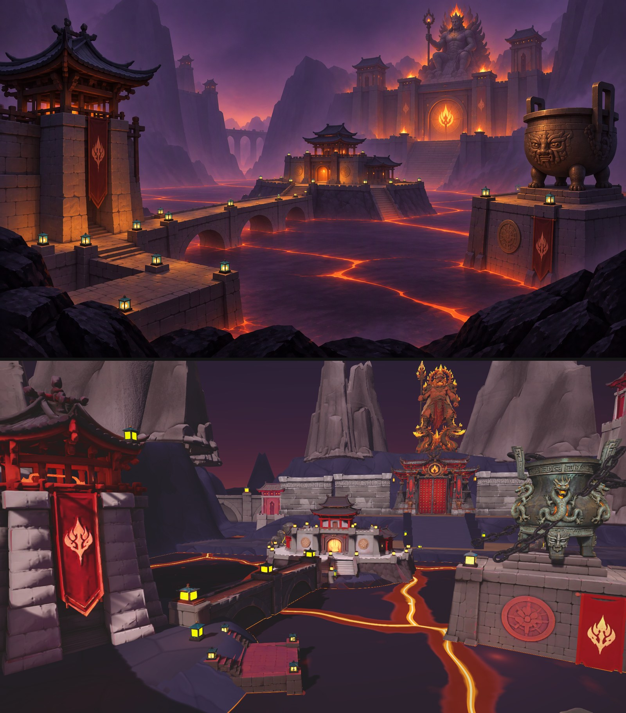

# 祝融火狱 3-1「熔湖关隘」场景套件（2026-11-07）

用户要求（11-06）：「做拆分实现，将场景中按照大中小物件进行拆分建模，用这些零散的物件建成一个场景套件，先完整搭建出一个场景」。
依据的场景概念图：[3-1-molten-lake-pass-v3.webp](../../art/reviews/ch3-zhurong-scene-concepts/3-1-molten-lake-pass-v3.webp)（修订经过见同目录 `prompts.md`）。

管线规范：[art/README.md](../../art/README.md)、[composition.md](composition.md)（场景美术的管线指南，用户 11-06 要求）、[ch3-look.md](ch3-look.md)；
Tripo Studio 路线脚本：[art/pipeline/tripo_studio/](../../art/pipeline/tripo_studio/README.md)；套件定义：`art/pipeline/tripo_studio/zhurong31_kit.py`。

## 1. 文化依据（用户 11-07：「游戏背景要以中国的一些文化为主」「第一章的怪物设计的就很有中国文化和地域特色」）

第一章好在每样东西都扣着一件具体的地域文物或典故（唐三彩镇墓兽、敦煌飞天、驮佛塔的蜃楼蟾、披札甲的跳鼠）。第三章照同样的做法，取**《山海经》祝融 + 南方楚地风物**：

| 依据 | 出处 | 落到哪件 |
|---|---|---|
| 「南方祝融，兽身人面，乘两龙」 | 《山海经·海外南经》 | 祝融像：脚踏两龙。11-07 先按字面做了「虎身人面」，用户看了说「太丑了，完全没有火神的气质」，给了一张参考图并定了方向：**火神形象、火元素多一些、兽元素多一些，但是人物的形态，乘龙；风格不要和项目差太大**。终稿 = 人形火神（红铜身）+ 兽元素（虎头盔、兽首肩甲、虎皮披肩、獠牙兽面）+ 火元素（火焰鬃发、脑后火焰光环、肩甲火焰、火焰矛、龙背火舌）+ 脚踏两条暗古铜龙 |
| 祝融为楚人先祖；南岳衡山祝融峰 | 《史记·楚世家》、衡山 | 整章取楚地（湖北 / 湖南）风物 |
| 楚式青铜（王子午鼎：束腰、外撇附耳、攀附龙兽）、曾侯乙铸铜 | 河南淅川下寺、湖北随州出土 | 镇湖鼎改楚式升鼎；第三章「铸」的母题 |
| 楚漆器黑底红纹（云纹、凤纹） | 楚墓漆器 | 宫门门楣、祝融像兽身纹饰、幡上的凤 |
| 「冠切云之崔嵬」：楚人高冠 | 屈原《涉江》 | 祝融像的高冠 |
| 宫门：朱漆门、门钉、铺首衔环 | 先秦至汉的宫门形制 | 宫门（去掉了概念图里奇幻的日轮圆门） |

已有怪物里的唐代镇河铁牛、明代一窝蜂 / 神火飞鸦、傩戏、变脸，和这套「南方 · 铸造」的设定一致。

## 2. 物理逻辑（用户 11-06：「熔岩里面为什么还会有船」）

碰到熔岩的只能是玄武岩、石头、铸铁；木构、布、纸只在离熔岩很远的石建筑高处。没有船、没有木码头、没有立在熔岩里的木桩。

## 3. 拆件清单

按 composition.md 的三级：大形（地形大面、巨型剪影）60%、中形（建筑、桥、平台）30%、小形（灯、火盆）10%，小形只放在焦点和路线节点附近。
中景不立假人形竖杆（幡杆、高灯柱），引导灯只做嵌在桥栏上的矮灯；火焰一律走 Unity 特效（`FX_` 挂点），网格上不长火。

| 级 | ID（`SM_Tripo_Zhurong*`） | 名称 | 在场景里的用途 | 登记尺寸 W×H×D（m） | Tripo 面数 |
|---|---|---|---|---|---|
| 大 | Statue | 祝融像（人形火神乘两龙） | 崖顶次焦点；右手火焰矛（不对称） | 14.6 × 28 × 9.3 | 30000 |
| 大 | PalaceGate | 祝融宫门（楚式） | 主焦点 | 22 × 18 × 8.2 | 30000 |
| 大 | FerryTower | 渡口关楼 | 近景左框（前景压暗） | 14 × 20 × 12 | 30000 |
| 大 | CustomsFort | 湖心税关（含岛基） | 中景建筑群 | 29.3 × 14 × 20.4 | 30000 |
| 大 | DingPier | 镇鼎墩 | 右侧中景大块面 | 14 × 8 × 14 | 15000 |
| 大 | CliffSpire | 玄武岩峰 | 火口崖壁 / 远景剪影，随机偏航缩放 | 43.6 × 45 × 21.7 | 15000 |
| 中 | Ding | 镇湖鼎（楚式升鼎） | 鼎墩顶上；四链用 `SM_Prop_InfernoChainLink` 运行时拼 | 6 × 8 × 4.5 | 15000 |
| 中 | DrumTower | 鼓楼 | 宫门两侧，一侧 ×0.8（地标不对称） | 7 × 20 × 7 | 15000 |
| 中 | PalaceWall | 宫墙段（素墙 + 回纹压顶） | 宫门两翼，首尾拼 | 16.6 × 12 × 4.8 | 8000 |
| 中 | ArchBridge | 石拱堤段（双拱带栏墩灯） | 主引导线 | 24.7 × 7 × 4.2 | 8000 |
| 中 | Landing | 石码头台 | 出生近景平台 | 14 × 4 × 10 | 8000 |
| 中 | ~~GrandStairs~~ | 宫前大阶 | **不走 Tripo**：两轮都被画成石供桌；台阶要和角色控制器尺度一致，改由场景构建器程序生成 | — | — |
| 中 | Boulders | 前景岩堆 | 前景框景、死角 | 8 × 4 × 6 | 8000 |
| 小 | ParapetLantern | 栏墩青金灯 | 唯一冷色点缀，只放栏墩上 | 1.05 × 1.6 × 1.05 | 3000 |
| 小 | Brazier | 铜火盆 | 宫门城垛、关楼台；火焰 = `FX_Fire` 特效 | 2.1 × 1.4 × 2.1 | 3000 |

地形（火口崖壁、湖床、岛体）走 Unity Terrain；熔湖用 `LevelKit.Ch3LavaCrust` 暗壳材质。

## 4. 四视图（Tripo Studio 图片页 GPT Image 2.5，免费额度）

- 附参考裁图（从概念图里裁出该物件）出四视图，再 `register_sheet.py` 登记；比例和登记尺寸对不上时按画出的比例改 `reference_dimensions`，不压扁图形（管线会拒）。
- 四面对称的小件（火盆、灯）侧视图常被画窄：用 `--same-front`。
- 参考裁图里带了火盆，GPT 就会把带火焰的火盆画进去（大阶、宫墙两次都这样）：这种件改纯文字出，并在最前面写「STRICTLY NOTHING ELSE」。
- **Tripo 图片页的提示词超过约 3000 字会静默失败**（页面没有报错、也不生成记录），控制在 2700 字以内。
- 11-07 试过 OpenAI 接口（新密钥 `credit_balance_exhausted`）和 Codex（ChatGPT 账号不支持 gpt-6.1-sol，gpt-6-luna 不出图），都不可用。

## 5. 建模（Tripo Studio，新账号）

设置：智能网格 → 多视图（前 / 左 / 右 / 后各一张 `crop_inputs.py` 出的 1024² 透明底图）→ 生成数量 1 → AI 模型 P2.0 → 拓扑「三角面」+ 面数（大件 30000、中件 8000–15000、小件 3000；三角面上限 50000，四边面 25000）。
纹理：左侧栏「纹理生成」模块（不要点模型下方的「纹理生成」快捷按钮——它直接按默认设置开跑，不开去光），**去光处理 开、4K**（20 积分；8K 是试用档）。设置不会保留，每件都要重新点。
导出：GLB、贴图 4k，文件名填资产 ID → `wait_dl.py` 等下载稳定 → `archive.py` 归档 + 收据。导航后的第一下点击常被页面吞掉：用页面脚本找「导出」按钮点开对话框、填文件名，再按坐标点对话框里的「导出」。

| 件 | Tripo 任务 | 实得面数 | 积分（网格 / 纹理） |
|---|---|---|---|
| Statue | 810f851f-4a1a-473e-b81f-0c9aa724c9a5 | 35659 | 100 / 20 |
| PalaceGate | 22c592b2-2aab-42a5-86ee-3c167377bc41 | 27512 | 0（试用）/ 30 + 20（第一次误用默认设置，去光重出） |
| FerryTower | 1c2878d3-794c-4a00-9616-733cb9a0c8fd | 28444 | 100 / 20 |
| CustomsFort | ddfa7642-bbf3-4050-9e94-0fc63c635f58 | 24812 | 100 / 20 |
| DingPier | 3c103210-ab2d-4249-9677-b9e6bd7c2782 | 14450 | 100 / 20 |
| CliffSpire | 88d5a829-d761-4cba-a474-9d88752685c6 | 16886 | 100 / 20 |
| Ding | 9d876135-32fb-4903-aa51-f94d227b0dbb | 14554 | 100 / 20 |
| DrumTower | b5d0a052-cab8-4743-a683-4609d01c3602 | 14886 | 100 / 20 |
| PalaceWall | 4bbb2b9d-d96f-481d-a9d5-b0f33704d867 | 7949 | 100 / 20 |
| ArchBridge | 5d94c211-c9bd-40a5-929b-94cd1f275d3c | 8136 | 100 / 20 |
| Landing | 86b1deb3-dd65-4773-82a7-50259987316c | 7967 | 100 / 20 |
| Boulders | b093afb8-2587-41a7-b3c0-85be11a747d5 | 7323 | 100 / 20 |
| ParapetLantern | bcceb290-6262-4e9f-869a-46890f2813c7 | 2861 | 100 / 20 |
| Brazier | 2bb14f92-a856-4ea1-9dd6-39e7099dcc8d | 2900 | 100 / 20 |

合计约 **1610 积分**（另有作废的旧祝融像网格 3002bf88，用的试用次数，没扣积分）。四视图全部走图片页免费额度。

## 6. 样板场景 ZR31（用这套件拼出概念图那一屏）

构建器 `unity/Assets/Pipeline/Editor/Levels/Level_ZhurongKit31.cs`（`[LevelBuilder("zr31")]`，`bridge.sh level zr31`），场景 `Assets/Scenes/ZR31_MoltenLakePass.unity`，纯美术：没有玩家、遭遇、NavMesh，不进构建设置。
按 composition.md 的顺序搭：

1. **大块面**：Unity Terrain 火口（椭圆 98 × 122 m，崖壁 +30–40）、南沿眺台 +12 / 岸台 +3、湖心岛、北岸码头 +2 → 台地 +10 → 宫后崖 +34；熔湖 = `LevelKit.Ch3LavaCrust` 暗壳；
   一圈 10 座玄武岩峰（随机偏航、40–62 m）；宫门（主焦点，20 m）、渡口关楼（近景左框，22 m）、湖心税关（15.5 m，自带岩基）、镇鼎墩（9 m）、崖顶祝融像（34 m，次焦点）。
2. **引导线**：两段双拱堤（码头 → 湖心税关）+ 一段（税关 → 北岸），程序大台阶（码头 +2 → 台地 +10，20 级，两侧挡墙）直指宫门；宫墙每侧两段，墙端鼓楼西 21 m / 东 27 m（不对称）。
3. **鼎 + 链**：鼎墩顶射线测鼎座高，升鼎 9 m，四条 `SM_Prop_InfernoChainLink` 巨链（两条拉到东崖、两条拴墩角）。
4. **小件最后**：岩堆 4 处（前景两处放在眺台下的岸台上，顶面低于眼高、不挡地平线）、火盆 2 + 点光、栏墩灯 6 + 点光（台阶脚两盏、堤两头各一对，按射线测到的实际顶面摆，脚下是熔岩就跳过）；宫门、祝融像火冠补暖色点光。火焰本体运行时由 `EnvFxHost` 按资产 ID 挂 `EnvFlame`。

摆件一律「底面中心 + 目标高度」等比缩放（`PutH`），不依赖发布尺寸；缺 Prefab 时放登记尺寸的白盒并记进报告。
远处另摆一排全套件（原始比例），截 `Kit` 总览。机位：Concept（对照概念图）、Spawn、Causeway、Ding、GateApproach、Statue、Aerial、Map、Kit。

**主机位按概念图的镜头反算布局**（11-07 第二轮）：Concept 机位用概念图的镜头——竖直 FOV 55°（游戏视角 70° 太广，地标全缩成小件；其余机位仍是 70°），
朝北偏西 13°、俯 6°，眼高约熔岩面上 14.7 m。概念图里每个地标的画面横坐标 → 相对视轴的角度，再配一个距离，用 `FromEye(角度, 距离)` 落到世界坐标：
关楼 −36° / 35 m（左 1/4），湖心税关 +4° / 70 m（中线偏右），镇鼎墩 +35° / 43 m（右缘），堤从关楼码头 −22° / 33 m 斜伸到税关西南角（侧面的拱朝镜头）。
宫门、祝融像、大台阶没动——视轴偏西 13° 正是由宫门和像在概念图里的位置反推出来的。
西北火口壁沿视线方向切出一道峡口（相对视轴 −11°，概念图中线偏左那道峡谷），谷底从熔岩河升到远处平地，峡中横一道渡槽（拱桥件放大到 18 m）；
峡口两侧的岩峰挪开让出视线。峡口要在北岸台地 / 宫后崖之后切（那两项横贯全宽，先切会被填回去）。

## 7. 验收（2026-11-07）

截图在 [review/zhurong-kit-31/](review/zhurong-kit-31/)（Concept / Spawn / Causeway / Ding / GateApproach / Statue / Aerial / Map / KitLarge / KitSmall），14 件的审核图总览 `kit-review-sheets.jpg`。
构建报告 `Assets/Art/_Review/zr31_report.txt`：0 不合格，14 件全部是正式 Prefab（没有白盒）。

`composition_check.py`（第二轮；概念图本身一并量了做基准）：

| 图 | 颜色 低/固有/高 | 明度 暗/中暗/中间/亮（均·跨） | 密度 安静/中等/密集 | 提示 |
|---|---|---|---|---|
| 概念图 v3（基准） | 48 / 48 / 4 | 51 / 45 / 4 / 0（20 · 35） | 17 / 65 / 18 | 留白不足 |
| Concept（主机位） | 60 / 36 / 5 | 51 / 44 / 4 / 1（21 · 28） | 24 / 37 / 39 | 留白不足、细节太满 |
| Causeway | 71 / 24 / 6 | 65 / 30 / 4 / 1（20 · 26） | 43 / 35 / 22 | — |
| Ding | 78 / 19 / 3 | 73 / 25 / 2 / 1（18 · 18） | 41 / 35 / 24 | 明度窄带 |
| GateApproach | 86 / 12 / 2 | 56 / 40 / 4 / 0（20 · 24） | 53 / 19 / 28 | 宫前全是石头、没有熔岩：没有点缀色、明度窄带属有意（composition.md 第 6 节：背景明度压窄留给怪） |

主机位的颜色、明度分布和概念图几乎一致；「留白不足」概念图本身也有（这一屏就是满构图）。密集区比概念图多一倍：
Tripo 贴图的砖石细纹、鼎身纹饰和熔岩亮缝的硬边比手绘的概念图碎——这是件本身的贴图密度，不在摆放上解决。

迭代里改掉的问题：
- 第一版地形沉在熔岩里：`Sample.h` 要加 `Base`（高度场 0 = 世界 y −Base），照 Level_3_1 写 `s.h = h + Base`。
- 湖面一张亮橙裂网（密集 33%）：暗壳改大板块细缝（`Ch3LavaCrust(molten 0.04, crack 0.035, emission 1.1, plateScale 0.035)`，约 28 m 一块），只剩几道长亮缝引向宫门、税关。
- 场景比概念图「大而空」：火口 98 × 122 → 70 × 88 m，宫门从 158 m 拉到约 120 m，宫门 / 神像 / 鼎墩 / 鼎 / 鼓楼 / 宫墙各放大一档。

第二轮（11-07）改掉的：
- 左前关楼只露一角 → 主机位换成概念图的镜头、按画面方位反算布局（见第 6 节），关楼占左 1/4、税关居中、宫门和像在右中、升鼎压右缘，和概念图一一对上。
- 近处熔岩亮斑 → 亮斑来自三处：热区化开的熔池、热区自动加宽的裂缝、壳上的冒泡亮点。`SF_Lava.shader` 新增 `_HeatCrackWiden`（默认 0.1）、`_BubbleAmount`（默认 0.45），
  `_MoltenAmount` 放开到负值（< 0 = 只有壳和缝）；默认值和原来的硬编码一样，其他关卡的熔岩不变。ZR31：molten −0.6、加宽 0.015、冒泡 0.06、缝宽 0.035、板块 0.045、壳色提到暗紫灰 (0.17, 0.13, 0.18)。
  现在湖面是暗紫灰硬壳 + 几道长亮缝，和概念图同一个读法。
- 熔岩不照物体：拱下、税关和鼎墩脚贴着熔岩面放低矮的橙色点光（Lava bounce），关楼加楼阁 / 门洞 / 正面三盏暖光。
- `LevelKit.Capture` 加可选参数 `firstIndex`（分几次调用、每次换 FOV 时接着编号）。

还差的：关楼正面石墙仍偏冷偏暗（概念图里它是左侧最暖的一块，点光照不透 Tripo 贴图的暗部）；远处岩峰比概念图亮、缺高度雾的层次；天空是平的暗红，没有概念图宫门后、峡口里那圈橙色地平线辉光；
套件还没接进正式关卡 3-1（`Level_3_1.cs` 仍用 ART6 那一套件）。

## 8. 贴图去紫（2026-11-07 晚，用户：「这些模型都泛紫色、灰色，生成的贴图太脏了」「这个贴图都是模糊的」）

**原因**：四视图提示词照美术文档写的是 "dark violet-grey basalt"，参考图又是从紫光概念图裁的、还要求「保留颜色」，
Tripo 把紫色暗部当成固有色烘进底色，去光处理只去明暗不去色相。场景光照本来就铺一层紫，固有色再紫一层，整件读成紫灰。
量出来的紫偏（Lab 色相在蓝紫 → 品红区间的纹素占比）：岩峰 100%、镇鼎墩 85%、拱堤 82%、岩堆 80%、鼓楼 67%、宫墙 62%、关楼 59%、税关 55%；
只有祝融像和升鼎是 0。

**修法**：新工具 `art/pipeline/texture_clean.py`（Lab 空间，原分辨率 4K，熔岩色键纹素原样不动）：
零星紫斑从周围中等彩度的材质借色（不借朱漆 / 旗面，否则石墙边抹出红痕），整片紫面中性化成低彩度暖灰，
浅色低彩度的粉紫残留转暖赭，真实材质色彩度 ×1.45 以内，亮度拉伸只给中性的石 / 铁（深红一提亮就成粉）。
**只改颜色，不做任何平滑**——第一版用均值漂移压平色块，细节跟着抹掉，用户指出「模糊」后撤掉。
13 件（除祝融像）走 `texture_clean.py hp --run` → import 成高模新版本 → build / validate / review → approve / publish。
宫门、升鼎洗完底色压缩率下降超了文件预算，加了「文件大小」豁免。

**源头**：本套件 registry 描述和 `zhurong31_kit.py` 的配色改成 "dark warm charcoal-grey basalt"，参考图那句改成「不要参考图的色光，
中性白光下画固有色」；`art/README.md` 熔火配色改为「暖炭灰玄武岩与铜 / 朱漆 / 橙色，紫色只在光照里」。

**模糊**：Tripo Studio「纹理生成」上传网格 + 使用原始 UV 重出的贴图（`retexture.py`）比原始生成明显糊、带紫斑——
第三章 Inferno 件今天的 v002 重贴图（另一会话，未发布）三样毛病全占，原始 v001 清晰不紫；那批件该回到 v001，不是再洗。

**结果**：13 件发布、Unity 重同步、ZR31 重建 0 不合格。对比图 [review/texture-clean/zr31-before-after.jpg](review/texture-clean/zr31-before-after.jpg)
（概念图 / 去紫前 / 去紫后）、[review/texture-clean/inferno-v001-vs-v002.jpg](review/texture-clean/inferno-v001-vs-v002.jpg)（用户截图里那四件的原始贴图对今天的重贴图）。
主机位构成自检：颜色 低 / 固有 / 高 60 / 36 / 5 → 81 / 14 / 6（原来算进「固有色」的是紫，现在石头是中性的），
明度跨度 28 → 39（暗部到亮部拉开了），密度 21 / 37 / 42。紫色现在只剩环境光和地形层。
